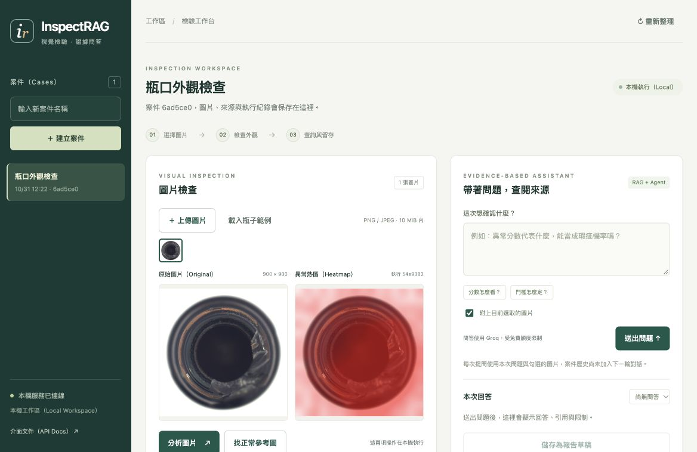

# InspectRAG Agent | Visual Inspection and Evidence Retrieval

A visual inspection workspace combining anomaly detection, Retrieval-Augmented Generation (RAG), and an AI agent to connect image analysis, document search, case follow-up, and report review.

**[Interactive Demo](https://chelsietao.github.io/InspectRAG-Agent/)** · **[繁體中文](README.zh-TW.md)** · **[Detailed Project Notes (Chinese)](README_DETAILED.md)**

The public demo presents precomputed images, heatmaps, and answer examples, while the local application supports image uploads, model inference, and live questions.

## Features

Inspection scores need method documentation and reference material for interpretation, so InspectRAG Agent keeps these records within a case and connects analysis results to source review and report confirmation.

| Feature | Implementation |
|---|---|
| Image analysis | Computes PatchCore anomaly scores, with a decision threshold and anomaly heatmap |
| Normal image retrieval | Retrieves three normal training images, with source paths and similarity scores |
| Document question answering | Combines semantic search and lexical matching, retrieving knowledge passages for answers with citations |
| Tool orchestration | Calls image, document, and case memory tools, recording their sequence, arguments, and results |
| Case memory | Saves historical analysis and user-confirmed observations, supporting follow-up questions with references to previous records |
| Report management | Saves answers and evidence as report drafts, recording versions and confirmation timestamps after user review |

For example, upload a bottle image and inspect its heatmap alongside normal reference images, then ask how to interpret the score or retrieve the previous decision threshold, with document passages or historical execution records available for review.

## Interface



The product images come from MVTec AD, with attribution and licensing recorded in the [image notes](docs/images/dashboard/README.md).

## Architecture and Technology

```text
Web workspace → FastAPI → Agent and tools → Results, citations, and reports
                           ├─ PatchCore: anomaly scores and heatmaps
                           ├─ Image retrieval: normal reference images
                           ├─ Document retrieval: passages and sources
                           └─ Case memory: historical results and confirmed observations
                      SQLite: cases, execution records, and report versions
```

| Component | Technology and implementation |
|---|---|
| Visual analysis | Python, PyTorch, Anomalib, PatchCore, ResNet18 |
| Retrieval | Sentence Transformers, multilingual E5 embeddings, FAISS, lexical matching, Reciprocal Rank Fusion |
| Agent question answering | Groq, tool calling, Pydantic argument validation, citation ID checks |
| Context management | Evidence snapshots capped at 6,000 characters per run, with source execution IDs and image scope |
| Backend and storage | FastAPI, SQLite, background jobs, request idempotency |
| Frontend and public demo | HTML, CSS, JavaScript, GitHub Pages |
| Testing | Python unittest, API integration tests, Node.js test runner |

Cases, images, tool results, and reports are linked by identifiers, duplicate requests return the original execution record, and reports retain versioned snapshots of answers and evidence.

## Data and Recorded Results

Experiments use the bottle category of MVTec AD, with 179 normal images for the memory bank, 30 normal images for threshold calibration, and 83 images for testing.

| Measure | Recorded result |
|---|---|
| Image AUROC | 0.9960 |
| Pixel AUROC | 0.9665, evaluated at 128 × 128 resolution |
| Anomalous images detected | 61 of 63 |
| False positives on normal images | 0 of 20 |
| Software tests | 118 passed in the case memory validation, comprising 105 Python and 13 JavaScript tests |

The image metrics correspond to the split and settings above, with full records in the [vision evaluation](docs/evaluation/vision_baseline_v1/metrics.json) and test results in the [validation summary](docs/evaluation/case_memory_v1/summary.json).

A recorded follow-up retrieved the previous score and threshold through two model calls, using `read_case_memory → submit_answer`, with the result preserved in the [execution record](docs/evaluation/case_memory_v1/live_followup.json).

## Run Locally

After preparing the data, model, indexes, and Groq configuration, run the following command from the project root.

```bash
.venv/bin/python -m uvicorn app.backend:create_app --factory --host 127.0.0.1 --port 8000 --workers 1
```

Open the [local workspace](http://127.0.0.1:8000/), create a case, and upload an image to analyze it, retrieve references, and ask questions, with the API available through [API Docs](http://127.0.0.1:8000/docs).

Setup instructions are provided in Chinese, covering [data preparation](docs/phase1_setup.md), the [vision model](docs/phase2_vision.md), [image and document indexes](docs/phase3_retrieval.md), [agent configuration](docs/phase4_agent.md), [workspace operation](docs/phase6_dashboard.md), and [case memory](docs/phase7_memory.md).

## Data Attribution and Method

Images are sourced from [MVTec AD](https://www.mvtec.com/research-teaching/datasets/mvtec-ad) under CC BY-NC-SA 4.0, with attribution and licensing for public assets and derived heatmaps in the [asset notes](docs/demo-assets/README.md).

Anomaly detection uses PatchCore by Karsten Roth and colleagues, described in [Towards Total Recall in Industrial Anomaly Detection (CVPR 2022)](https://arxiv.org/abs/2106.08265), with the authors' implementation available in the [Amazon Science repository](https://github.com/amazon-science/patchcore-inspection).
