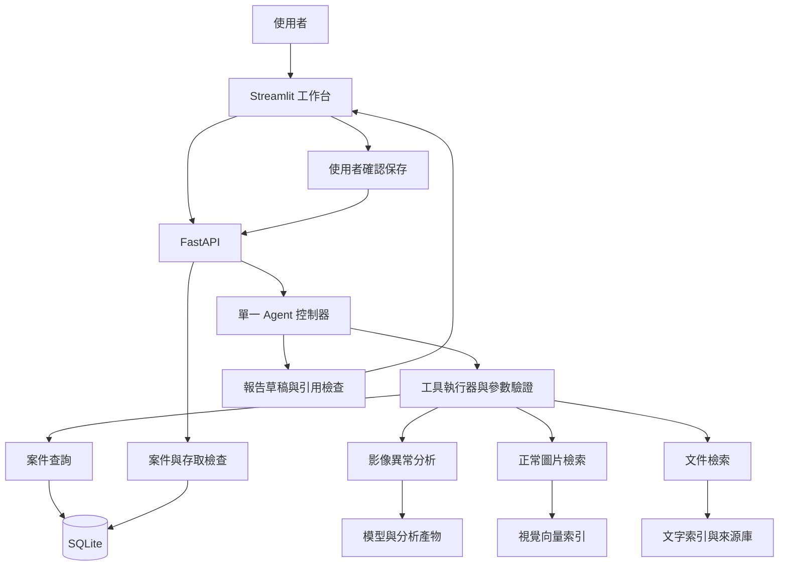

# InspectRAG Agent

## 結合視覺異常檢測、文件 RAG 與工具呼叫的品質檢驗工作台

> 專案狀態：規劃與文件階段，現階段交付第一版中文 README，應用程式、模型、資料下載、評估與部署均尚未完成。
>
> 本文件中的功能、指標與時程屬於預定設計，實測結果會在實作後補入，現有內容不代表已通過測試或具備正式生產環境能力。

## 1. 專題摘要

InspectRAG Agent 面向品質工程師的影像檢驗與資料查詢情境，使用者建立案件並上傳瓶子影像，系統呼叫視覺模型產生異常分數與熱圖，搜尋正常參考圖片，並透過 RAG 檢索資料集說明、模型文件與版本化實驗報告，再整理成附證據的分析草稿。

Agent 負責選擇工具與協調流程，後端負責執行工具、驗證參數、保存案件狀態與限制執行次數，使用者能追問結果限制、查看引用段落，並確認要保存的報告版本。

第一版以 MVTec AD 的 bottle 類別為範圍，專題成果聚焦於公開基準資料上的視覺分析、文件問答與案件流程，真實產線資料與產品允收判定需要另行驗證。

### 專題目標

- 建立可追溯的影像分析流程，保存模型、輸入與分析產物的版本資訊。
- 建立附引用的文件 RAG，讓每項文件主張能回到來源段落。
- 建立受控的單一 Agent，根據需求呼叫檢測、檢索與案件工具。
- 建立案件記憶與上下文管理，支援追問與跨對話查詢。
- 建立可驗證的後端與部署流程，提供 API、測試、日誌與執行文件。
- 建立分層評估，檢查視覺、檢索、回答與工具流程的品質。

## 2. 要解決的問題與痛點

### 2.1 影像結果與相關文件分散

檢驗人員取得模型分數後，仍需要查閱模型說明、資料集範圍與評估報告，才能判斷結果的含義與限制，分散的資訊增加查找與整理成本。

本系統將分析結果與文件證據放入同一個案件，使用者可從熱圖進入追問，也可從回答展開來源段落，減少重複輸入與來源追查工作。

### 2.2 分數與熱圖需要解釋

異常分數描述影像相對於正常特徵的偏離程度，其數值受到模型與前處理設定影響，使用者需要知道分數尺度、判定門檻與模型版本，避免把異常分數當成瑕疵機率。

本系統以結構化數值、正常參考圖與文件說明協助解讀，對於缺少校準依據的結果，顯示分數與限制並保留人工複核狀態。

### 2.3 生成式回答缺少可核對證據

模型可能產生文件未支持的根因解釋或修復建議，因此回答需將量測結果、文件主張與情境推論分開呈現，並附上對應的證據 ID。

本專題的資料可支持外觀異常分析與方法說明，製程根因、產品允收條件與修復方式需要額外知識來源，資料不足時需回覆限制。

### 2.4 多輪操作容易失去案件狀態

使用者可能在分析後追問「這張圖用了哪個模型」「剛才的熱圖表示什麼」，系統需要保留案件與版本關係，並確保對話切換後不混用其他案件的資訊。

本系統保存結構化案件狀態與來源引用，對話摘要用於延續互動，已確認事實與模型推論則分開保存。

### 2.5 展示原型需要工程證據

作品集需要能重現的環境與可定位的錯誤紀錄，因此專題將 API 設計、測試、執行追蹤與版本資訊納入交付，讓評閱者能檢查功能如何運作及何時失敗。

## 3. 目標使用者與使用案例

| 使用者 | 使用情境 | 需要取得的資訊 |
|---|---|---|
| 品質工程師 | 檢視一張疑似異常圖片 | 異常分數、區域與參考影像 |
| 模型開發者 | 查詢某次分析的設定 | 模型版本、前處理與門檻 |
| 技術審閱者 | 查核報告是否有依據 | 文件段落與量測來源 |
| 學習或面試評閱者 | 檢查端到端系統 | API、Agent trace、測試與評估 |

本專題以內部工具原型為產品定位，公開示範版本先提供固定範例與單使用者流程，多使用者部署需要加入身分驗證、資料隔離與配額管理。

## 4. 使用者操作流程

1. 建立案件，輸入標題與可選的備註。
2. 上傳影像，由後端檢查格式、大小與解碼結果。
3. 選擇 bottle 類別，確認輸入符合目前模型適用範圍。
4. 提問或開始分析，由 Agent 呼叫所需工具。
5. 查看異常分數、熱圖與相似正常影像，確認工具結果。
6. 追問方法或結果限制，由系統檢索對應版本的文件。
7. 取得報告草稿，查看每項主張的來源與不確定處。
8. 由使用者按下確認保存，後端建立報告版本與審閱紀錄。

### 範例問題

- 「分析這張圖片，標出可疑區域並提供正常參考圖」，需要影像分析與圖片搜尋工具。
- 「這個異常分數可以當成瑕疵機率嗎」，需要方法文件與本次分數設定。
- 「這次分析用了哪個模型版本」，需要案件中的結構化分析紀錄。
- 「根據目前資料，可以判斷製程根因嗎」，需要檢查知識範圍並說明證據限制。
- 「整理這個案件的報告，附上來源」，需要組合既有量測與文件證據。

以上是互動需求示例，具體回答與數值需在系統完成及測試後產生。

## 5. 第一版範圍與延伸範圍

### 5.1 第一版 MVP

| 項目 | 第一版範圍 | 驗收方式 |
|---|---|---|
| 資料 | MVTec AD bottle | 建立資料清單、雜湊與切分紀錄 |
| 視覺 | PatchCore 基準與熱圖 | 固定測試集與影像、像素級評估 |
| 圖片檢索 | 正常訓練影像參考庫 | 檢查來源與排序，排除自我匹配 |
| 文件 RAG | 5 至 10 份經審閱文件 | 固定問答集與引用支持度評估 |
| Agent | 單一 Agent 與受控工具呼叫 | 測試工具選擇、錯誤與停止條件 |
| 記憶 | 案件事實、摘要與證據 ID | 多輪與跨對話案件測試 |
| 後端 | FastAPI 與 SQLite | API 與資料一致性測試 |
| 介面 | Streamlit 案件頁 | 完成上傳、追問與報告保存 |
| 工程 | Docker、pytest、GitHub Actions | 乾淨環境啟動與 CI 紀錄 |

### 5.2 第一版後的擴充

MCP adapter 將在核心工具穩定後加入，預計先公開文件搜尋與案件讀取兩個工具，並完成工具探索與呼叫測試，支援 MCP 的聲明需以實際連線結果為依據。

PostgreSQL、多使用者權限、背景工作佇列、更多產品類別與額外模型屬於後續擴充，會依使用量與評估結果決定優先順序。

多 Agent 協作與模型微調需要獨立的效益評估，第一版先以單一 Agent 完成可驗證工作流程，避免流程複雜度超過實際需求。

## 6. 資料來源與資料治理

### 6.1 影像資料

MVTec AD 是工業外觀異常檢測基準，包含超過 5,000 張高解析度影像、15 個物件與材質類別，以及像素級異常標註，正常訓練影像與含異常的測試資料已有既定安排，適合作為第一版資料來源。[官方資料集頁面](https://www.mvtec.com/research-teaching/datasets/mvtec-ad)

本專題先採 bottle 子集，下載後核對資料夾、可讀性、影像尺寸與遮罩對應，實際張數與檔案雜湊將寫入 data manifest，尚未下載前保留為待確認。

資料授權為 CC BY-NC-SA 4.0，儲存庫將保存取得方式、來源與使用條件，原始影像與第三方文件的公開分發範圍需依各自條款處理。[官方授權說明](https://www.mvtec.com/research-teaching/datasets/mvtec-ad)

### 6.2 文件知識庫

| 文件類型 | 回答範圍 | 整理方式 |
|---|---|---|
| 資料集說明 | 類別、標註、切分與資料限制 | 登錄來源並整理可使用段落 |
| PatchCore 方法論文 | 方法原理與原始實驗設定 | 保存引用位置與來源摘要 |
| Anomalib 模型文件 | 實作元件與使用限制 | 記錄查閱日期與適用版本 |
| 專題實驗報告 | 本專題模型表現與失敗案例 | 從已完成實驗生成版本化文件 |
| 專題操作文件 | 上傳、查詢、錯誤與報告流程 | 由實際功能與測試結果維護 |

文件知識庫需人工篩選與整理，現成資料集省下影像標註成本，文件審閱與問答評估仍屬於專題工作，預計先建立 30 至 80 個可引用段落，再依問題覆蓋調整。

### 6.3 文件 metadata

每個段落保存 `document_id`、`chunk_id`、標題、作者或機構、來源網址、章節或頁碼、查閱日期、授權狀態、內容雜湊與適用版本，引用時使用穩定 ID，避免更新文件後指向錯誤內容。

文件中的外部指令視為待閱讀文字，工具執行與系統規則由應用程式控制，檢索內容無權修改案件或要求讀取憑證。

### 6.4 資料切分與防止洩漏

- 模型特徵庫只使用允許的正常訓練影像，測試影像與遮罩保留作最終評估。
- 圖片參考庫使用訓練影像並排除當前輸入本身，記錄每筆圖片的原始切分。
- 若需要設定正常判定門檻，從正常訓練資料保留校準子集，設定目標假陽性率並記錄規則。
- 正常校準影像不進入特徵庫，結果需標記為自訂校準設定，與官方完整訓練設定分開報告。
- 最終測試遮罩不參與門檻調整，無足夠校準資料時先展示分數及排名，保留二元判定為待校準。
- RAG 開發題與保留評估題分開，題目標準答案及測試標註不放入檢索庫。
- 實驗報告可收錄已完成的整體評估結果，逐題測試答案、逐圖標籤與解答對照表隔離保存。

## 7. 技術架構



### 7.1 預定技術組合

| 元件 | 技術 | 用途與選擇理由 |
|---|---|---|
| 語言 | Python | 將視覺、檢索與後端整合於同一語言 |
| 視覺模型 | PyTorch、Anomalib、PatchCore | 建立可參考既有實作的異常基準 |
| 影像處理 | OpenCV、Pillow、NumPy | 解碼、前處理與熱圖疊合 |
| 圖片搜尋 | 視覺特徵、FAISS | 建立正常參考圖的向量索引 |
| 文件處理 | Markdown、JSONL，PDF 解析器按來源選定 | 保留段落結構與來源位置 |
| 文字檢索 | Sentence Transformers、FAISS、詞彙匹配 | 支援中文問題與英文文件的檢索實驗 |
| LLM | 具工具呼叫能力的模型，供應商待選 | 解讀問題、選擇工具與整理回答 |
| Agent | Python 狀態管理與工具執行器 | 控制回合、錯誤與案件狀態 |
| 結構驗證 | Pydantic | 驗證 API、工具與模型輸出 |
| 後端 | FastAPI | 提供有 schema 的 API |
| 儲存 | SQLite、SQLAlchemy、本機檔案 | 保存案件與版本，影像以物件 ID 管理 |
| 前端 | Streamlit | 建立可互動的案件操作介面 |
| 測試與品質 | pytest、Ruff、GitHub Actions | 執行測試、靜態檢查與回歸檢查 |
| 部署 | Docker、可掛載持久磁碟的雲端環境 | 重現執行環境並保存案件資料 |
| MCP 擴充 | 官方 Python SDK，版本待確認 | 將穩定工具包裝為可被探索與呼叫的服務 |

上述為預定組合，套件版本、相容性與模型授權需在實作階段確認並鎖定，執行環境尚未建立，因此本文件不提供未驗證的安裝指令。

## 8. 視覺異常檢測設計

### 8.1 基準方法

PatchCore 使用預訓練模型擷取影像局部特徵，從正常資料建立特徵庫，推論時比較輸入特徵與正常特徵的距離，形成影像分數及區域異常圖，實作依據可參考 [Anomalib PatchCore 文件](https://anomalib.readthedocs.io/en/latest/markdown/guides/reference/models/image/patchcore.html)。

此流程重點在特徵擷取與記憶庫建置，預訓練骨幹是否凍結、是否更新權重需在設定中註明，履歷與報告應描述實際完成的模型工作。

### 8.2 處理流程

1. 驗證圖檔能解碼，統一色彩模式並保留原圖尺寸。
2. 依鎖定的模型設定調整尺寸與正規化，保存前處理版本。
3. 以正常訓練影像建立特徵庫，保存樣本選取與隨機種子。
4. 推論輸入影像，取得原始分數與異常圖。
5. 將熱圖映射回原圖座標，保留縮放方式與顯示範圍。
6. 有校準門檻時輸出對應狀態，缺少門檻時顯示未校準。
7. 保存模型版本、輸入雜湊、設定與耗時，供案件追查。

### 8.3 分數與面積的解讀

原始異常分數用於排序與評估，介面的色階正規化只影響顯示，兩者需分開保存，避免將每張圖個別拉伸後的顏色當成跨圖嚴重程度。

只有在像素門檻已定義時才計算「超過門檻的面積比例」，該數值描述模型標記區域，實際瑕疵面積與品質嚴重度仍需額外驗證。

### 8.4 正常參考圖搜尋

從正常訓練資料擷取圖片級特徵並建立索引，回傳前 3 張參考影像及距離分數，參考結果用於比較正常外觀，第一版不宣稱能辨識瑕疵類型或製程根因。

## 9. 文件 RAG 設計

### 9.1 資料進入索引

文件經來源確認後轉為結構化段落，以章節與主題切分，再計算文字向量並建立索引，段落保留來源位置與版本，文件更新時根據內容雜湊重建對應索引。

段落初始長度以約 300 至 600 tokens 作為試驗範圍，標題、表格與短定義採結構化處理，最終參數依開發集調整。

### 9.2 查詢與證據選取

先依問題辨識模型名稱、資料集、版本與案件範圍，結合詞彙匹配與向量檢索取得候選，再去重並控制同一來源的重複段落數，初始候選數取前 5 段作為實驗設定。

中文問題與英文原文需以跨語言測試檢查檢索能力，候選不足時允許一次改寫補查，無法找到證據則輸出資料不足。

### 9.3 引用與回答規則

- 文件中的定義與方法主張，需附本次讀取過的 `chunk_id`。
- 本次分析數值，需指向對應的 `analysis_id` 與模型版本。
- 推論與未確認內容，放入限制或待確認欄位。
- 使用者要求製程根因或產品放行判定，需先檢查是否有對應的合格來源。
- 引用 ID 有效性由程式檢查，主張是否得到來源支持由人工評估作為品質依據。

檢索相似度與模型自評皆不能替代語意支持度審閱，報告需保留評分規則及不支持的案例。

## 10. Agent 與工具編排

### 10.1 工具定義

| 工具 | 主要輸入 | 回傳內容 |
|---|---|---|
| `analyze_image` | 案件 ID、影像 ID、模型版本 | 分數、熱圖 ID、校準狀態與耗時 |
| `search_reference_images` | 影像 ID、類別、候選數 | 參考影像 ID、距離與來源切分 |
| `search_documents` | 問題、版本篩選與候選數 | 段落 ID、來源、摘要與分數 |
| `read_evidence` | 段落 ID 清單 | 段落內容與來源資訊 |
| `get_case_history` | 案件 ID | 分析、確認事實與報告版本 |
| `draft_report` | 案件 ID、分析與證據 ID | 待審閱報告草稿 |

工具參數只接受後端登錄的資源 ID，檔案路徑、資料庫查詢與使用者身分由伺服器解析，避免模型自行指定任意本機路徑或跨案件資料。

### 10.2 工具執行流程

Agent 取得使用者問題與案件摘要後提出工具動作，後端檢查參數、資源歸屬與配額，再執行工具並回傳結構化結果，Agent 根據結果決定補查、追問、產生草稿或停止。

每個動作保存工具名稱、參數摘要、狀態、耗時與錯誤碼，執行摘要呈現可觀察的工具紀錄，供使用者與開發者追查。

### 10.3 控制規則

- 每次使用者提問最多呼叫 8 次工具，達到上限後回覆已取得內容與限制。
- 文件改寫補查最多一次，重複參數可使用有版本鍵的快取。
- 工具逾時與重試次數由設定檔控制，暫時性錯誤最多重試一次。
- 缺少圖片時請求補充圖片，缺少案件時請求選擇案件。
- 報告草稿可由 Agent 建立，確認保存由使用者操作經 API 執行。
- Agent 不具有部署、刪除案件或執行任意 shell 的工具，這些操作保留在應用程式管理範圍。

### 10.4 Prompt Engineering

提示分為角色與範圍、工具使用規則、引用規則及輸出 schema，提示版本與模型設定一同寫入執行紀錄，修改提示後使用固定評估題檢查回歸。

模型輸出不符合 schema 時允許一次格式修復，仍失敗則回傳結構化錯誤，避免在介面呈現無法解析的半成品。

## 11. Context Management 與 Agent Memory

### 11.1 上下文層次

| 層次 | 保存內容 | 作用 |
|---|---|---|
| 本輪工作狀態 | 待完成工具、已取得證據與剩餘次數 | 控制一次問題的執行 |
| 對話摘要 | 使用者問題、已說明限制與未解事項 | 支援多輪追問 |
| 案件長期紀錄 | 分析版本、確認事實、報告與回饋 | 支援跨對話查詢 |

### 11.2 記憶保存原則

模型推論、工具輸出與使用者確認事實分別標記來源類型，新增記憶需保存時間、案件 ID 與證據 ID，摘要不能覆寫原始分析結果。

同一案件換用新模型時建立新的分析版本，舊版本仍可追查，使用者提出修改或刪除要求時，由後端更新對應紀錄與衍生摘要。

### 11.3 Token 預算

預計將案件狀態、近期對話與引用段落設定獨立配額，超出配額時先去除重複段落，再保留與當前問題相關的摘要，實際 token 上限需在選定模型後量測與設定。

最終 prompt 保存內容版本與 token 用量，記憶省略時保留原始資料 ID，允許透過工具重新讀取完整內容。

## 12. 後端 API 與資料模型

### 12.1 預計 API

| 方法與路徑 | 用途 | 主要檢查 |
|---|---|---|
| `POST /cases` | 建立案件 | 欄位與識別資訊 |
| `POST /cases/{id}/images` | 上傳圖片 | 大小、格式與案件歸屬 |
| `POST /cases/{id}/analyses` | 提交分析 | 模型版本與冪等鍵 |
| `GET /analyses/{id}` | 查詢分析 | 狀態與產物可用性 |
| `POST /cases/{id}/messages` | 提問與工具編排 | 上下文、配額與執行狀態 |
| `GET /runs/{id}` | 查詢工具執行摘要 | 案件歸屬與錯誤碼 |
| `POST /cases/{id}/report-drafts` | 建立草稿 | 分析與證據 ID |
| `POST /reports/{id}/confirm` | 使用者確認保存 | 報告版本與冪等性 |
| `GET /health` | 程序存活狀態 | 基本服務狀態 |
| `GET /ready` | 依賴就緒狀態 | 模型、索引與資料庫 |

分析與 Agent 執行使用 `pending`、`running`、`succeeded`、`failed` 狀態，第一版可採單一受控執行器，程序中斷後將未完成工作標記為可辨識的失敗，可靠佇列與跨程序恢復列為擴充。

### 12.2 SQL 資料表

| 資料表 | 保存內容 |
|---|---|
| `cases` | 案件標題、狀態與建立時間 |
| `images` | 圖片物件 ID、雜湊與類別 |
| `analyses` | 模型、分數、校準與熱圖版本 |
| `documents`、`chunks` | 文件來源與段落 metadata |
| `conversations`、`messages` | 對話與案件關係 |
| `memories` | 已確認事實、摘要及來源類型 |
| `agent_runs`、`tool_calls` | 追蹤 ID、工具狀態與耗時 |
| `reports`、`report_evidence` | 報告版本、確認狀態與證據關聯 |
| `feedback` | 使用者回饋與修正原因 |

圖片與模型產物存於檔案儲存區，SQL 保存 ID 與 metadata，關聯表使用外鍵與交易維持一致性，重複提交以冪等鍵處理。

## 13. MCP 擴充設計

MCP 是應用程式與工具服務之間的協定，host、client 與 server 的責任需分開，實作將依官方架構與選定 SDK 版本建立 adapter。[MCP 官方架構](https://modelcontextprotocol.io/docs/learn/architecture)

第一個 MCP server 預計公開 `search_documents` 與 `get_case_history`，沿用後端服務層與資料驗證，避免 REST 與 MCP 各自維護不同查詢邏輯。

本機先使用 stdio 傳輸進行整合驗證，測試需涵蓋初始化、工具探索、合法呼叫、錯誤參數與案件隔離，完成後再評估遠端傳輸與身分驗證。

MCP adapter 完成前，工具呼叫經應用程式內部介面運作，文件與履歷中的功能狀態依實際交付更新。

## 14. AI 評估與測試設計

### 14.1 視覺評估

| 指標 | 說明 | 報告要求 |
|---|---|---|
| Image AUROC | 影像級正常與異常排序能力 | 保存逐圖分數與標籤 |
| Pixel AUROC | 像素級異常區域排序能力 | 記錄 resize 與聚合方式 |
| 正常假陽性率 | 校準門檻下的正常誤報比例 | 記錄校準來源與分母 |
| 推論延遲 | 單張影像分析耗時 | 報告硬體、冷啟動與 p50、p95 |
| 失敗案例 | 漏檢、誤報與熱圖錯位 | 保存影像 ID 與分析原因 |

Pixel AUROC 可能受正常像素占比影響，評估報告需搭配熱圖與失敗案例檢查，必要時增加區域指標，視覺品質門檻在基準實驗後訂定並記錄理由。

### 14.2 RAG 評估

預計建立 20 題開發集與 30 題保留測試集，題目包含方法說明、資料限制、版本查詢與無法回答情境，每題人工標註相關段落、可支持主張及可接受的回答狀態。

| 指標 | 計算方式 | 初期目標 |
|---|---|---|
| Recall@5 | 命中的相關段落數除以全部標註相關段落數，再取題目平均 | ≥ 85% |
| 引用 ID 有效率 | 有效且已讀取的引用數除以全部引用數 | 100% |
| 主張支持率 | 有證據支持的可核對主張數除以全部可核對主張數 | ≥ 90% |
| 不足處理成功率 | 正確說明缺少資料且未編造的題數除以不足題總數 | ≥ 90% |

上述為開發目標，結果尚未量測，報告需同時列出樣本數、分母與評分理由，沒有相關段落的題目以不足處理評分。

### 14.3 Agent 與工作流程評估

另建 30 個流程案例，涵蓋正常分析、多輪追問、缺圖、超出類別、索引缺失、工具逾時、無效參數、回合上限與報告確認，檢查最終狀態及必要工具是否符合預定規格。

保留每題的模型、提示、工具次數、token、耗時與狀態，對模型輸出具有隨機性的題目重複執行 3 次，觀察成功率與變動範圍。

### 14.4 對照實驗

以相同模型、知識庫與問題集評估「無檢索回答」「固定 RAG 流程」與「Agent 加 RAG」，無檢索組的引用指標標記為不適用，其他組記錄品質、工具預算、延遲與成本差異。

視覺實驗可比較特徵庫抽樣比例與輸入解析度，使用開發設定選擇方案後再執行最終測試，測試結果不回流用於調參。

### 14.5 工程測試

- 單元測試涵蓋資料欄位、ID 對應、引用檢查與狀態轉移，檢查行為契約。
- API 測試涵蓋上傳錯誤、案件隔離、重複提交與版本衝突，檢查邊界條件。
- 整合測試以假的 LLM 回傳與小型固定資料驗證流程，避免每次 CI 依賴外部 API。
- 真實模型評估由手動或受控排程觸發，設定資料與費用預算並保存結果。
- 回歸測試檢查修正過的失敗案例，防止提示或工具變更導致問題重現。

## 15. 可觀測性、除錯與部署

每次請求產生 `request_id`，Agent 工作保存 `run_id`，案件與分析使用獨立 ID，結構化日誌串接各階段的狀態與耗時，錯誤回覆顯示可追查識別碼。

預計記錄解碼、模型推論、圖片檢索、文件檢索與 LLM 呼叫耗時，憑證、完整私人輸入與敏感欄位不寫入公開日誌，展示資料的保存期限另以設定管理。

Docker 分離應用設定與資料目錄，SQLite 與分析產物掛載持久磁碟，雲端環境若只提供暫存磁碟則不支援持久案件聲明，部署前需驗證重啟後資料仍可讀取。

公開 Demo 優先使用固定範例，開放上傳與雲端 LLM 前需加入檔案大小、請求頻率、呼叫次數及花費上限，模型憑證由環境變數或受管理設定讀取。

GitHub Actions 預計執行程式風格、單元與 API 測試、資料 schema 檢查及 Docker build，正式部署先採手動觸發，雲端平台與費用方案在實作階段選定。

## 16. 實作步驟與八週里程碑

本時程以每週約 10 至 15 小時為規劃假設，初學框架、下載限制與硬體條件可能增加工時，MCP 與雲端部署安排在核心流程完成後。

| 週次 | 工作 | 交付與驗收 |
|---|---|---|
| 第 1 週 | 確認需求、下載 bottle、整理文件來源、定義 schema | 資料清單、切分規則與 5 個手動案例 |
| 第 2 週 | 建立視覺基準、保存分數與熱圖、檢查座標 | 可重現推論與第一份視覺報告 |
| 第 3 週 | 建立正常圖片索引與文件 RAG | 圖片搜尋、引用與開發集結果 |
| 第 4 週 | 實作 Agent、工具執行器與限制 | 工具 trace、追問與錯誤處理 |
| 第 5 週 | 建立 API、SQL 案件與對話記憶 | 案件版本、冪等性與整合測試 |
| 第 6 週 | 完成介面與報告確認流程 | 上傳到報告保存的端到端示範 |
| 第 7 週 | 執行保留評估、整理失敗案例、建立 CI | 評估報告、回歸案例與 CI 結果 |
| 第 8 週 | Docker、部署驗證與 MCP adapter | 可重現環境、工具連線結果與展示影片 |

若進度超出預期，先完成單類別、單使用者與本機執行，MCP 及雲端部署以待完成項目保留，文件同步更新交付範圍。

## 17. 預計專案目錄

以下為後續實作的目錄規劃，現階段僅建立 README，其他檔案將依里程碑新增。

```text
InspectRAG-Agent/
├── README.md
├── pyproject.toml
├── .env.example
├── .gitignore
├── Dockerfile
├── compose.yaml
├── .github/workflows/ci.yml
├── app/
│   ├── main.py
│   ├── api/
│   ├── schemas/
│   ├── services/
│   ├── vision/
│   ├── retrieval/
│   ├── agent/
│   ├── memory/
│   ├── storage/
│   └── observability/
├── ui/streamlit_app.py
├── mcp_server/
├── prompts/
├── scripts/
│   ├── validate_data.py
│   ├── build_vision_bank.py
│   ├── build_document_index.py
│   └── run_evaluation.py
├── configs/
├── data/
│   ├── manifests/
│   ├── source_registry.jsonl
│   └── reviewed_chunks.jsonl
├── evaluation/
│   ├── dev_cases.jsonl
│   ├── heldout_cases.jsonl
│   ├── workflow_cases.jsonl
│   └── rubric.md
├── tests/
│   ├── unit/
│   ├── integration/
│   └── api/
└── docs/
    ├── architecture.md
    ├── data_card.md
    ├── decisions/
    ├── evaluation/
    └── demo/
```

原始影像、模型權重、特徵庫、私有文件、執行資料庫與憑證預計排除於 Git，公開儲存庫保存可分享的文件、建置方法、資料清單與評估結果，必要的大型產物另依授權安排儲存。

## 18. 本機開發與重現規劃

預定流程為取得專案、建立隔離環境、安裝鎖定依賴、取得資料、建立視覺與文字索引，再啟動 API 和介面，實際指令將在乾淨環境驗證後補入。

CPU 環境先確認推論可用性，GPU 可用時記錄型號與記憶體占用，影像解析度、特徵庫大小及 LLM 路由都納入設定，現階段不承諾特定硬體上的速度。

純文件與工程測試使用 mock 模型即可執行，真實 LLM 的供應商與憑證在需要整合時再確認，README 中不保存任何金鑰。

每次實驗保存程式 commit、資料 manifest、模型識別碼、索引版本、提示版本、設定與執行環境，讓評估結果能回到產生它的條件。

## 19. 預期成果與交付標準

### 19.1 預期成果

使用者能完成圖片上傳、結果檢視、文件追問與報告確認，並能查看數值與文件主張的依據，開發者能透過 trace 追查每次工具使用與錯誤。

專題預計形成一套資料、模型、檢索、Agent 與後端共同運作的原型，實際效益由評估與試用結果支持，節省工時與降低錯誤等成效需另外量測。

### 19.2 交付檢查表

- [ ] 完成 bottle 資料清單與切分驗證，標註資料來源及授權。
- [ ] 完成視覺基準與正常圖片索引，保存可重現設定。
- [ ] 完成文件 RAG 與來源顯示，支援資料不足處理。
- [ ] 完成 Agent 工具迴圈與停止規則，保存工具執行摘要。
- [ ] 完成案件記憶與版本關聯，通過跨案件與多輪測試。
- [ ] 完成 API、SQL 與報告確認流程，具備錯誤回覆與追蹤 ID。
- [ ] 完成視覺、RAG 與 Agent 評估，列出實測數值與失敗案例。
- [ ] 完成 Docker 與 CI，驗證乾淨環境可啟動。
- [ ] 完成部署與持久性檢查，記錄可操作範圍。
- [ ] 完成 MCP adapter 的探索與呼叫測試，依結果更新功能聲明。
- [ ] 完成架構圖、操作截圖與約 3 至 5 分鐘展示影片，所有成果可回到版本紀錄。

## 20. 風險與處理方式

| 風險 | 影響 | 處理方式 |
|---|---|---|
| 訓練與測試資料混用 | 評估偏高 | 以 manifest 驗證切分，限制索引來源 |
| 異常分數被當成機率 | 使用者誤解結果 | 顯示尺度、校準狀態與說明 |
| 參考圖相似度缺少語意保證 | 形成過度解釋 | 限定為正常外觀參考，另作人工檢查 |
| 文件缺少根因資料 | 生成無依據建議 | 回覆不足並保留人工複核 |
| Prompt injection | 檢索內容影響操作 | 固定工具權限與參數驗證 |
| Agent 重複或逾時 | 延遲與費用增加 | 回合上限、快取與有限重試 |
| 案件狀態混用 | 回答錯用證據 | 案件歸屬檢查與證據關聯驗證 |
| 文件與模型版本不符 | 解釋不適用 | 依版本篩選並保存來源快照資訊 |
| 部署資料未持久化 | 重啟後案件遺失 | 掛載持久磁碟並測試重啟 |
| 公開 Demo 被大量呼叫 | 費用與資源風險 | 固定範例、頻率限制與預算 |

## 21. 能力對應與履歷呈現

| 能力 | 預計完成的證據 |
|---|---|
| LLM Agents 與工具編排 | 工具 schema、狀態管理與任務評估 |
| RAG 與知識系統 | 文件索引、引用、固定題集與支持度評估 |
| Prompt Engineering | 版本化提示與回歸結果 |
| Context management 與 memory | 案件狀態、摘要與記憶來源紀錄 |
| Backend 與 API integration | FastAPI、SQL、版本與冪等性 |
| System design 與 debugging | 模組邊界、設計決策與結構化 trace |
| Testing 與 AI evaluation | 單元、整合與模型評估報告 |
| DevOps 與工程自動化 | Docker、CI 與部署紀錄 |
| MCP | adapter 與協定整合測試，完成後列入成果 |
| GitHub portfolio | 可重現專案、提交紀錄與展示文件 |

實作完成後，履歷可描述「建立整合視覺分析、文件 RAG 與工具呼叫的內部工作流程原型，並以固定評估集檢查來源支持及任務完成品質」，實際數字、部署範圍與使用者規模需填入量測結果。

公開儲存庫代表作品集交付，正式 production 經驗、開源專案貢獻及團隊協作經驗需按實際參與另外呈現。

## 22. 參考來源

- [MVTec AD 官方資料集](https://www.mvtec.com/research-teaching/datasets/mvtec-ad)，用於資料內容、評估資源與授權確認。
- [PatchCore 原始論文](https://openaccess.thecvf.com/content/CVPR2022/html/Roth_Towards_Total_Recall_in_Industrial_Anomaly_Detection_CVPR_2022_paper.html)，用於方法理解與基準設計。
- [Anomalib PatchCore 文件](https://anomalib.readthedocs.io/en/latest/markdown/guides/reference/models/image/patchcore.html)，用於實作介面與模型元件確認。
- [FastAPI 官方文件](https://fastapi.tiangolo.com/)，用於 API、資料驗證與測試設計。
- [Sentence Transformers 官方文件](https://www.sbert.net/)，用於文字向量與語意檢索。
- [FAISS 官方儲存庫](https://github.com/facebookresearch/faiss)，用於向量索引與相似度搜尋。
- [MCP 官方架構](https://modelcontextprotocol.io/docs/learn/architecture)，用於協定角色與工具服務整合。

參考來源供後續實作確認，知識庫實際收錄清單、內容使用條件與套件版本會在資料與環境建置後更新。
