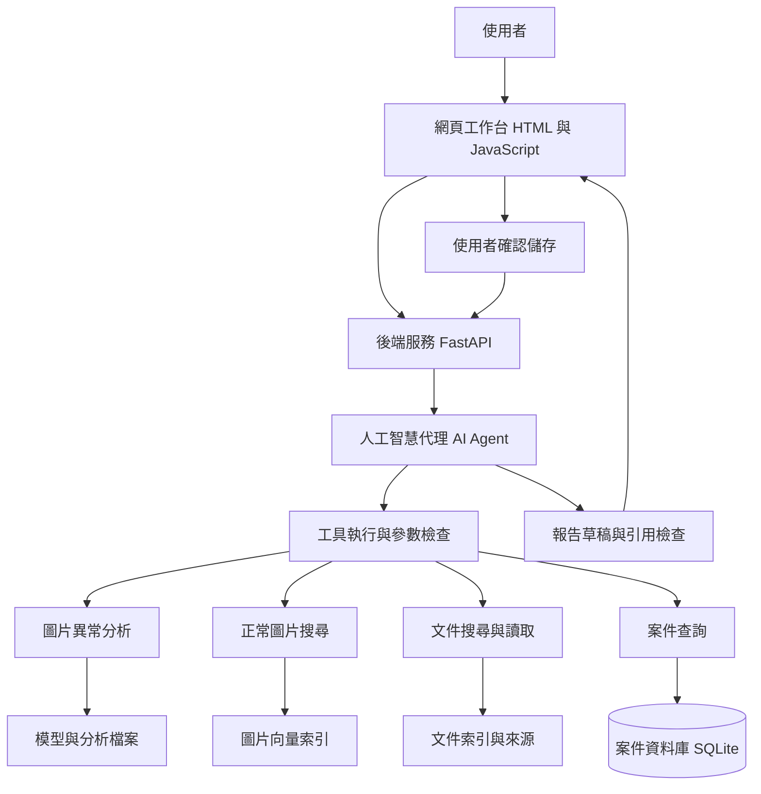

# InspectRAG Agent

**[開啟公開互動展示 ↗](https://chelsietao.github.io/InspectRAG-Agent/)**

公開展示版免登入，呈現真實預先計算的圖片、熱圖、正常參考與附來源追問，任意圖片上傳與即時 AI 問答請使用下方的本機版本。

## 把圖片檢查、文件查詢和案件紀錄接在一起，做成品質檢驗用的 AI 工作台

> 目前進度：資料、視覺基準（Vision Baseline）、檢索（Retrieval）與命令列代理（CLI Agent）已完成，Groq 可呼叫本機圖片與文件工具並產生附引用回答，案件資料庫、本機後端介面（API）與網頁工作台（Web Dashboard）已完成，有來源的案件記憶與追問已完成，免費公開展示已加入，MCP 與完整後端雲端部署仍待實作。
>
> 文中的對話、數字與案件名稱屬於示範，功能表現會在實作後用測試結果更新。


## 已完成：第一階段資料檢查

已檢查 209 張正常訓練圖片、20 張正常測試圖片與 63 張異常測試圖片，63 張瑕疵遮罩均可讀取、尺寸吻合，且包含二元標註內容，沒有發現訓練與測試之間像素完全相同的圖片。

資料驗證程式另以損毀檔案、缺少遮罩、尺寸不符、空白遮罩與資料重複等案例進行測試，10 項測試通過，詳細步驟見[第一階段執行說明](docs/phase1_setup.md)，檢查結果見[資料報告](data/manifests/bottle_validation.md)。

這些結果只代表檔案與結構檢查通過，近似重複圖片與標註的語意正確性尚未驗證，模型品質也要等視覺階段評估。

## 已完成：第二階段視覺基準

使用 179 張正常圖片建立特徵庫（Memory Bank），另保留 30 張正常圖片校準門檻，83 張測試圖片最後才用於評估，本次找出 63 張異常圖片中的 61 張，20 張正常圖片沒有誤報。

影像級排序指標（Image AUROC）為 0.9960，128 × 128 解析度的像素級指標（Pixel AUROC）為 0.9665，單張推論能重新載入模型並產生熱圖，完整設定、漏檢案例與執行方式見[第二階段說明](docs/phase2_vision.md)。

這些結果僅對應一種類別與目前的自訂設定，模型分數無法當成瑕疵機率，近似重複與真實產線適用性也尚未驗證。

## 已完成：第三階段圖片與文件搜尋

正常圖片搜尋（Image Retrieval）已建立 179 張正常訓練圖片的參考庫，排除校準與測試資料，也會排除像素相同的查詢圖片，文件知識庫（Knowledge Base）則保留來源網址、段落編號與適用說明。

文件以本機多語言向量模型（Multilingual Embedding Model）和文字比對搜尋，12 題保留題的前五段召回率（Recall@5）為 100%，全部 24 項程式測試通過，題目與摘要由同一專題建立，尚待使用者與獨立評閱者審查。

目前回傳的是文件候選與來源，生成回答、拒答與主張支持評估仍在後續範圍，操作方式與 Mac 程序隔離（Process Isolation）設計見[第三階段說明](docs/phase3_retrieval.md)。

## 已完成：第四階段生成回答與代理工具

已接上 Groq 的工具呼叫（Tool Calling），新版圖片案例用兩次 API 呼叫完成分析、正常參考圖與文件整理，輸出附引用的結論和限制，完整程式測試共 50 項通過。

程式停用自動重試與模型切換，先前圖片流程遇到免費額度限制（Rate Limit）的紀錄也保留，帳號需維持免費方案，模型 API 無法驗證計費層級。

目前檢查引用編號與工具流程，主張支持度（Claim Support）仍需人工審閱，操作指令與實測紀錄見[第四階段說明](docs/phase4_agent.md)，公開範例見[生成回答](docs/evaluation/agent_v1/image_answer.md)。

## 已完成：第五階段案件資料庫與後端介面

已加入本機後端（FastAPI）與案件資料庫（SQLite），可以上傳圖片、送出圖片分析或代理問答、查回執行紀錄，並把有回答的結果保存成報告草稿，完成審閱後寫入確認時間。

完整測試共 70 項通過，其中 20 項涵蓋後端，真實圖片經介面上傳後可產生熱圖，重送取得同一筆執行，服務重新啟動後結果仍保留，本次驗證沒有新增外部語言模型呼叫。

第五階段完成案件歷史保存，跨輪案件記憶與追問已在第七階段接上，本階段原有操作方式見[第五階段說明](docs/phase5_backend.md)，本機啟動後可開啟[互動介面文件](http://127.0.0.1:8000/docs)。

## 已完成：第六階段網頁工作台

網頁工作台（Web Dashboard）已接上案件、上傳、圖片分析、正常參考圖搜尋、來源問答與報告審閱，圖片分析與參考圖搜尋在本機執行，按下送出問題後才呼叫 Groq。

程式驗證共 90 項通過，包含 81 項 Python 與 9 項 JavaScript 測試，瀏覽器已完成真實圖片分析與搜尋，問答和報告確認以獨立離線替身驗證，本階段沒有新增外部語言模型呼叫。


畫面中的產品影像來自 MVTec AD，截圖的來源與授權標示見[圖片說明](docs/images/dashboard/README.md)，操作指令、測試範圍與限制見[第六階段說明](docs/phase6_dashboard.md)。

## 已完成：第七階段案件記憶與追問

案件記憶（Case Memory）已接上歷史工具結果與使用者確認觀察，追問時保存最多 6,000 字元的證據快照，標示來源執行、圖片範圍與資料類型，模型舊回答不作為新事實。

真實追問以兩次 Groq 呼叫讀回前次分數與門檻，工具流程只有讀取記憶與提交回答，這一輪沒有重新分析圖片，完整測試共 118 項通過，觀察確認與撤回也完成離線瀏覽器驗證。

撤回觀察會影響之後建立的快照，舊回答與舊報告保留來源紀錄，引用失效觀察的結果無法新建或確認報告，操作、資料升級與實測範圍見[第七階段說明](docs/phase7_memory.md)。

## 1. 我想做什麼，為什麼選這個題目

我想做一個能處理圖片、查文件，又能記住目前案件的工具，讓使用者上傳一張瓶子照片後，可以接著問「哪裡看起來有問題」「這個分數代表什麼」「剛才的結果是用哪個模型算的」，最後把有依據的內容整理成報告草稿。

我把第一版的使用情境放在品質檢驗，因為一張照片的分析結果，往往還需要搭配模型說明、資料範圍和測試紀錄，才能知道結果能用到什麼程度。

例如畫面顯示瓶口附近有一塊紅色區域，使用者接下來可能想知道，那個顏色代表模型覺得外觀異常，還是已經確認產品有瑕疵，系統需要把計算結果和說明文件接起來，才能回答這類問題。

我也想透過這個題目練習人工智慧代理（AI Agent）、檢索增強生成（Retrieval-Augmented Generation，RAG）、後端開發（Backend Development）和人工智慧評估（AI Evaluation），讓每一項技術都有對應的使用需求和驗收方式。

### 用一句話說明這個專題

上傳一張產品照片，讓系統找出外觀可疑的位置、提供正常圖片作為參考，再查文件說明結果與限制，並把整個過程留在同一個案件裡。

## 2. 我想解決哪些麻煩

### 2.1 看到了分數，還是不知道怎麼理解

影像模型（Vision Model）可能回傳一個異常分數（Anomaly Score），例如示範畫面上出現 0.8，使用者還需要知道這個數值怎麼算、跟哪些正常圖片比較，以及這個版本的模型該用什麼門檻判斷。

因此我會把分數、模型版本和判斷條件放在一起，缺少校準資料時，就在結果旁邊標明「目前只有異常分數，是否需要複查仍要由人確認」，避免把 0.8 解讀成 80% 的瑕疵機率。

### 2.2 圖片放一邊，文件又在另一邊

假設使用者看到瓶口的熱圖（Heatmap），想知道「這種分析方式對反光有什麼限制」，他可能需要回頭翻模型文件或實驗報告，才能找到相關段落。

我想把這個查資料的動作放進工作台，使用者可以沿著剛才的結果追問，回答旁邊也能展開文件出處，確認說明是從哪裡來的。

### 2.3 回答看起來合理，卻找不到根據

大型語言模型（Large Language Model，LLM）能整理文字，但回答的流暢程度無法保證內容有依據，因此我會把回答拆成「工具量到什麼」「文件怎麼說」「目前還不知道什麼」三部分。

例如工具量到某個區域偏離正常外觀，現有資料若沒有製程紀錄，系統就需要說明無法確認成因，讓使用者知道下一步需要補什麼資料。

### 2.4 問第二個問題時，系統忘了剛才在看哪張圖

使用者上傳圖片後，可能接著問「剛才那張用了哪個模型」，系統需要保留案件、圖片和分析版本的關係，才能接得上這句話。

我會把這些資訊存進案件紀錄，之後重新開啟對話時，也能查回已經完成的分析，同時檢查目前問的是哪一個案件。

### 2.5 做出畫面後，還要能查問題和重跑結果

我希望這個專題能讓別人下載後照著文件執行，遇到錯誤時，也能從紀錄找到卡在哪個步驟，因此測試、版本資訊和部署方式都會列入交付內容。

## 3. 使用者會怎麼操作

以下用「檢查一張瓶子照片」走一次流程，所有數值與回答都只是預想範例。

| 步驟 | 使用者做什麼 | 系統需要做什麼 |
|---|---|---|
| 1 | 建立「瓶子檢查 A」案件 | 建立案件識別碼（Case ID） |
| 2 | 上傳圖片 | 檢查檔案大小、格式與是否能開啟 |
| 3 | 按下分析 | 呼叫模型，保存分數與熱圖 |
| 4 | 問「哪裡比較可疑」 | 顯示分析結果，提供正常參考圖 |
| 5 | 問「這個分數能代表什麼」 | 查模型文件，附上來源段落 |
| 6 | 問「幫我整理這次檢查」 | 整理報告草稿，列出依據與限制 |
| 7 | 看完草稿後按確認 | 儲存報告版本與確認紀錄 |

### 我希望回答長什麼樣子

> **本次分析結果**，模型在瓶口附近給出較高的異常反應，請搭配熱圖查看範圍，數值以這次分析紀錄為準。
>
> **可以怎麼理解**，模型比較的是輸入圖片與正常樣本的特徵距離，分數的判讀需要搭配模型版本與校準設定，相關依據列在來源段落中。
>
> **目前的限制**，現有資料只有影像分析與方法說明，還無法據此確認製程成因或產品是否符合出貨標準。
>
> **資料出處**，提供本次分析編號、模型版本、參考圖片與文件段落，讓使用者能回頭核對。

這份回答格式會作為開發方向，實際文字只能引用工具回傳的結果與已讀取的文件，尚未取得的數值和來源都不能填入。

## 4. 第一版做到哪裡

第一版的最小可行產品（Minimum Viable Product，MVP）先處理一種類別，也就是 MVTec AD 資料集中的瓶子（bottle），目標是把上傳、分析、查資料、追問和報告儲存串起來。

| 功能 | 第一版要完成什麼 | 我會怎麼確認有做對 |
|---|---|---|
| 圖片分析 | 分數與熱圖 | 用既有標註評估，人工查看失敗例子 |
| 正常圖片搜尋 | 找出 3 張參考圖 | 確認來源、排序與是否找回自己 |
| 文件問答 | 根據 5 至 10 份文件回答 | 檢查找到的段落和引用內容 |
| 工具協作 | 由代理選擇需要的工具 | 檢查呼叫順序、參數與停止條件 |
| 案件記憶 | 保存分析、摘要和確認資訊 | 測試追問與重新開啟案件 |
| 報告草稿 | 整理結果、來源和限制 | 確認數字與引用都能對回紀錄 |
| 操作介面 | 上傳、提問、看結果與確認報告 | 走完一個案件流程 |
| 工程交付 | 測試、環境設定與部署文件 | 在新的環境重跑一次 |

模型上下文協定（Model Context Protocol，MCP）安排在核心工具穩定後加入，第一版先讓工具能在程式內運作，再把文件搜尋與案件查詢開放給支援此協定的程式呼叫。

多產品類別、多使用者權限與多代理系統（Multi-Agent System）留到後續評估，第一版先把一個代理的工作流程做完整。

## 5. 資料從哪裡來，我要自己整理多少

### 5.1 圖片使用現成資料集

我會使用 MVTec AD 資料集（Dataset），官方提供超過 5,000 張圖片、15 種物件與材質類別，以及像素級標註（Pixel-level Annotation），可以用來檢查模型是否找到異常位置。[官方資料說明](https://www.mvtec.com/research-teaching/datasets/mvtec-ad)

第一版只取 bottle 類別，下載後檢查每張圖是否能開啟、尺寸是否合理，以及異常圖片是否有對應的遮罩（Mask），實際張數與檔案資訊會記錄在資料清單（Data Manifest）中。

遮罩可以理解成一張對照圖，裡面標出資料集認定的瑕疵區域，評估時可以把模型熱圖和它對照，檢查模型有沒有把注意力放在對的位置。

資料授權是姓名標示、非商業性、相同方式分享 4.0（CC BY-NC-SA 4.0），下載與分享內容時需要遵守官方條款，原始資料的取得方式也會寫進專案文件。[官方授權說明](https://www.mvtec.com/research-teaching/datasets/mvtec-ad)

### 5.2 問答用的文件需要整理

影像資料已經有標註，問答需要的知識庫（Knowledge Base）仍要挑選來源，我會先整理與這個專題有關的資料，再依使用者問題補足內容。

| 來源 | 可以回答什麼 | 例子 |
|---|---|---|
| 資料集官方說明 | 資料有哪些類別與限制 | 「這個模型的測試資料從哪裡來」 |
| PatchCore 論文 | 方法怎麼比較正常與異常 | 「為什麼只用正常圖建立特徵庫」 |
| Anomalib 文件 | 使用的實作元件與設定 | 「這個版本會產生哪些輸出」 |
| 自己完成的實驗報告 | 這個專題實際量到的表現 | 「目前在哪些圖片容易判錯」 |
| 自己寫的操作說明 | 系統功能與錯誤處理 | 「上傳失敗時可以怎麼處理」 |

初期預計整理 5 至 10 份文件，切成約 30 至 80 個能獨立閱讀的段落，每段都保留出處和適用版本，實際數量會依問題能否回答來調整。

我會分開保存來源原文與自己整理的摘要，公開到 GitHub 的內容也要確認使用條件，讓之後引用和修改都有依據。

### 5.3 每段文件要記住哪些資料

每個段落都會附上來源資訊（Metadata），包含文件名稱、作者或機構、網址、頁碼或章節、查閱日期、適用版本與段落識別碼（Chunk ID），之後點開引用時才能找到對應內容。

檔案也會計算雜湊值（Hash），可以把它想成用來辨識內容的指紋，當文件或圖片更新時，就能知道原本的索引是否需要重建。

### 5.4 哪些資料能拿來學，哪些要留著考試

訓練集（Training Set）用來建立正常外觀，測試集（Test Set）留到評估時使用，這個區分需要在程式讀取資料時就固定，避免資料洩漏（Data Leakage）。

例如某張測試圖已經出現在圖片搜尋庫裡，搜尋時可能找回同一張圖，結果就無法代表遇到新圖片時的表現，因此圖片索引也只使用允許的正常訓練資料。

若需要設定判斷門檻，我會從正常訓練資料中保留一部分作為校準集（Calibration Set），這部分不放進正常特徵庫，校準設定與官方完整訓練設定的差異也會在報告中說明。

問答的開發集（Development Set）用來調整檢索與提示，保留測試集（Held-out Test Set）則用來評估，標準答案與逐題解答不放進知識庫，實驗報告只收錄允許公開的整體結果。

## 6. 每項技術在這裡負責什麼

| 工作 | 預計使用的工具 | 白話說明 |
|---|---|---|
| 主要程式 | Python | 把資料、模型、問答與後端接起來 |
| 圖片分析 | PyTorch、Anomalib、PatchCore | 從正常圖片建立外觀特徵，再找出偏離的位置 |
| 圖片處理 | OpenCV、Pillow、NumPy | 開圖、調整尺寸與疊上熱圖 |
| 相似圖片搜尋 | 視覺向量、FAISS | 把圖片變成可比較的數值，再找接近的正常圖 |
| 文件搜尋 | Sentence Transformers、FAISS、詞彙比對 | 找到跟問題有關的文件段落 |
| 文字整理 | 支援工具呼叫的大型語言模型 | 理解問題、選工具與整理附來源的回答 |
| 工具控制 | Python 狀態管理 | 決定能用哪些工具、何時停止與怎麼處理錯誤 |
| 資料格式檢查 | Pydantic | 檢查欄位、型態與必要資訊是否完整 |
| 後端介面 | FastAPI | 接收圖片、問題與報告儲存要求 |
| 案件資料 | SQLite、Python sqlite3 | 保存案件、分析、問題與報告版本 |
| 使用者介面 | HTML、CSS、JavaScript | 讓使用者上傳圖片、看熱圖與提問 |
| 程式品質 | unittest、Node.js 測試執行器 | 檢查程式行為與修改後有沒有弄壞舊功能 |
| 執行環境 | Docker | 把需要的環境整理好，讓別人能照相同方式啟動 |
| 工具對外連接 | MCP 官方 Python SDK | 讓支援協定的程式探索與呼叫工具 |

資料、視覺、檢索、代理、後端與網頁工具的版本及實測結果已寫入各階段文件，Docker、持續整合（GitHub Actions）與 MCP 仍屬後續範圍，乾淨環境與部署驗證也會依完成狀態補上。

### 6.1 整體架構怎麼接

系統架構（System Architecture）會把畫面、後端、代理、工具與資料儲存分開，讓其中一項修改時，可以知道哪些部分需要跟著測試。



## 7. 圖片分析怎麼做

### PatchCore 的研究背景與原始來源

PatchCore 是 Karsten Roth 等六位研究人員提出的工業影像異常偵測演算法（Industrial Visual Anomaly Detection），論文列出的研究單位包含德國圖賓根大學（University of Tübingen）與亞馬遜雲端服務（Amazon AWS），並註明研究在 Amazon AWS 研究實習期間進行。[原始論文與研究單位](https://arxiv.org/html/2106.08265v2)

| 項目 | 資訊 |
|---|---|
| 論文名稱 | Towards Total Recall in Industrial Anomaly Detection |
| 作者 | Karsten Roth、Latha Pemula、Joaquin Zepeda、Bernhard Schölkopf、Thomas Brox、Peter Gehler |
| 首次公開 | 2021 年 6 月 15 日，於 arXiv 公開第一版 |
| 正式發表 | 2022 年電腦視覺與模式辨識會議（IEEE/CVF Conference on Computer Vision and Pattern Recognition，CVPR） |
| 研究領域 | 電腦視覺（Computer Vision）、工業異常偵測（Industrial Anomaly Detection） |
| 免費閱讀 | [arXiv 論文頁面](https://arxiv.org/abs/2106.08265)、[論文全文](https://arxiv.org/html/2106.08265v2) |
| 原作者程式碼 | [Amazon Science 官方 GitHub 儲存庫](https://github.com/amazon-science/patchcore-inspection) |

首次公開日期與作者名單可在 [arXiv 紀錄](https://arxiv.org/abs/2106.08265)核對，正式發表資訊與原作者程式碼可參考 [官方儲存庫](https://github.com/amazon-science/patchcore-inspection)。

我把 PatchCore 作為這個專題的視覺基準（Vision Baseline），目前使用 Anomalib 提供的實作（Implementation），本機的 ResNet18、輸入解析度與特徵庫設定會依實驗紀錄說明，原作者方法與本專題的整合工作也會分開註記。

### 7.1 先建立一個能重跑的基準

我會先用 PatchCore 作為基準方法（Baseline），透過預訓練模型（Pretrained Model）取出圖片局部特徵，再用正常圖片建立特徵庫（Memory Bank），分析時比較新圖片與正常特徵的距離。[Anomalib 方法說明](https://anomalib.readthedocs.io/en/latest/markdown/guides/reference/models/image/patchcore.html)

特徵（Feature）可以理解成模型整理出的外觀線索，例如局部紋理和邊緣的數值表示，這些內容會轉成向量（Embedding），供後續計算相似程度。

這個階段主要練習資料處理、特徵擷取與異常評估，骨幹網路（Backbone）是否固定、權重有沒有更新，都會在實驗設定中寫清楚，履歷也依實際完成的工作描述。

### 7.2 實作順序

1. 讀取圖片，保留原始尺寸並檢查色彩模式。
2. 完成前處理（Preprocessing），依設定調整大小與數值範圍。
3. 建立正常特徵庫，記錄使用圖片、抽樣比例與隨機種子（Random Seed）。
4. 執行推論（Inference），取得異常分數和異常分布圖。
5. 把熱圖對回原圖座標，檢查縮放後有沒有偏移。
6. 保存分析結果，附上模型版本、輸入圖片與處理設定。

例如圖片原本是 1,000 × 1,000，模型輸入改成 256 × 256，顯示時就需要把結果對回原圖，才能讓使用者在正確位置看到可疑區域。

### 7.3 熱圖與門檻要怎麼呈現

正規化（Normalization）可以調整數值範圍，若每張熱圖各自把最大值拉到最紅，就需要說明這個顏色只能在該張圖內理解，跨圖片比較時應回到原始分數與一致設定。

判斷門檻（Decision Threshold）需要經過校準（Calibration），有門檻後才能計算超過門檻的區域比例，這個比例代表模型標記範圍，實際瑕疵面積與嚴重程度仍要另外確認。

## 8. 文件問答怎麼做

### 8.1 先把文件整理成能搜尋的段落

文件切塊（Chunking）會依章節與主題把內容分成段落，初期先試約 300 至 600 個文字計算單位（Token），再根據測試調整長度，表格和短定義則保留各自的結構。

Token 是模型處理文字時使用的單位，跟中文字數或英文單字數沒有固定的一比一關係，因此設定長度時需要用選定模型的計算方式確認。

段落轉成向量後放進向量索引（Vector Index），可以把索引想成協助尋找相近內容的目錄，原文、網址和版本仍保留在文件資料裡。

### 8.2 使用者問問題後會發生什麼

例如使用者問「這個分數有什麼限制」，系統先取得目前案件的模型版本，再結合關鍵字搜尋（Keyword Search）與語意搜尋（Semantic Search），找出可能有關的文件段落。

初期先取前 5 段候選內容，刪除重複段落並檢查版本，內容不足時允許改寫問題補查一次，還是找不到依據就回覆資料不足。

使用中文提問、搜尋英文文件時，會用跨語言檢索（Cross-lingual Retrieval）的測試題確認表現，避免只因為介面能顯示中文，就假設檢索也能處理中文問題。

### 8.3 回答怎麼附來源

引用（Citation）會對應本次讀過的段落編號，分析數值則對應分析識別碼（Analysis ID），程式會檢查這些編號是否存在，以及是否屬於目前案件。

例如回答寫「這次分析使用模型 v1」，就需要從分析紀錄取得版本，回答寫「這個分數的尺度與設定有關」，則需要有文件段落支持，推測內容放在限制或待確認欄位。

## 9. 代理怎麼選工具

工具呼叫（Tool Calling）可以理解成模型提出「我需要執行哪個功能、帶入哪些資料」，實際執行由後端負責，執行結果再交回模型決定下一步。

工具編排（Tool Orchestration）處理的是這些動作的順序，例如先分析圖片，再搜尋文件，最後整理報告，遇到缺資料時也需要知道該追問還是停止。

| 工具名稱 | 中文用途 | 回傳內容 |
|---|---|---|
| `analyze_image` | 分析圖片 | 分數、熱圖、模型版本與花費時間 |
| `search_reference_images` | 搜尋正常參考圖 | 圖片編號、距離與資料來源 |
| `search_documents` | 搜尋文件 | 段落編號、來源與摘要 |
| `read_evidence` | 讀取來源段落 | 原文、出處與適用版本 |
| `read_case_memory` | 讀取本輪綁定的案件記憶 | 歷史工具結果、確認觀察與來源編號 |
| `submit_answer` | 提交有來源的回答 | 主張、引用、限制與需要補充的資訊 |

### 9.1 用例子看工具怎麼接

使用者說「分析這張圖片，順便說明結果」，代理會先取得分析結果，再查相關說明，將兩者組合成回答，工具選擇與結果都留在執行紀錄（Execution Trace）中。

使用者接著問「剛才用了哪個版本」，代理可以讀取記憶中的模型檢查點雜湊（Checkpoint SHA-256）與來源執行，回答會標明歷史結果，需要方法定義時再查文件，報告草稿由使用者透過畫面與 API 建立。

### 9.2 我會替代理設哪些限制

- 每次提問最多呼叫 8 次工具，達到上限就說明已完成哪些工作，以及剩下什麼。
- 同一個文件問題最多補查一次，避免在相同問題上反覆搜尋。
- 模型 API 的自動重試（Retry）次數設為零，逾時（Timeout）或免費額度不足時保留錯誤，不切換付費供應商。
- 本輪工具使用快取（Cache）避免重做相同要求，跨輪歷史結果透過有來源的記憶讀取，需要新的測量時另開工作。
- 工具參數（Tool Parameters）只接受已登錄的資源編號，檔案位置與案件權限交由後端處理。
- 代理只有讀取與回答工具，觀察確認、撤回與報告審閱由使用者在畫面操作。

### 9.3 提示怎麼寫，修改後怎麼檢查

提示工程（Prompt Engineering）會把角色、工具規則、引用要求與輸出格式寫清楚，例如明定「缺少文件時要說明不足」「分析數字只能來自工具結果」，再用固定題目檢查修改前後的表現。

資料結構規格（Schema）定義回答應有哪些欄位，以及欄位接受什麼型態，模型格式不合時允許修復一次，仍無法解析就回報錯誤，避免把缺一半的報告當成完成。

## 10. 系統要記住什麼，怎麼避免記錯

上下文管理（Context Management）限制這次回答能帶入的資訊，案件記憶（Case Memory）保存可查回的來源，本版以同案件、同圖片與指定執行建立快照，舊模型回答留在歷史問答中。

| 資訊層次 | 保存什麼 | 使用方式 |
|---|---|---|
| 本輪證據 | 工具結果與剩餘次數 | 只有本輪取得的來源編號可以引用 |
| 歷史量測 | 分數、門檻、模型雜湊與來源執行 | 標示前次結果，未重新分析 |
| 確認觀察 | 描述、圖片範圍、確認與撤回時間 | 標示使用者提供，未經獨立驗證 |
| 問題提示 | 最多兩筆近期問題 | 協助理解追問，無法當作證據 |

例如你確認「拍攝時瓶口有反光」，系統會保存為使用者觀察，模型無法替你確認或將推測寫成觀察，撤回後的新快照會排除該筆資料，引用失效觀察的歷史結果也會顯示提醒。

記憶快照最多 6,000 字元，完整模型上下文最多 22,000 字元，每輪最多五次模型與八次工具呼叫，超過限制時停止，完整長對話摘要與語意挑選觀察仍待擴充。

快照與工作在同一個資料庫交易中保存，相同請求重送會取回原快照，來源與撤回處理的完整規則見[第七階段說明](docs/phase7_memory.md)。

## 11. 後端怎麼設計

應用程式介面（Application Programming Interface，API）負責接收畫面送來的要求，再交給對應服務處理，畫面與工具也能共用這些服務，避免同一套規則在不同地方各寫一份。

### 11.1 已提供的本機 API

| 方法與路徑 | 用途 | 需要檢查什麼 |
|---|---|---|
| `POST /cases`、`GET /cases` | 建立與列出案件 | 標題與必要欄位 |
| `POST /cases/{case_id}/images` | 上傳圖片 | 格式、尺寸與案件關係 |
| `POST /cases/{case_id}/runs` | 送出分析或代理問答 | `kind`、圖片、問題與請求編號 |
| `GET /cases/{case_id}/runs/{run_id}` | 查執行結果 | 狀態、回答、引用與錯誤 |
| `GET /cases/{case_id}/runs/{run_id}/heatmap` | 取回熱圖 | 檔案與案件關係 |
| `POST /cases/{case_id}/reports` | 建立報告草稿 | 成功且有回答的代理執行 |
| `POST /cases/{case_id}/reports/{report_id}/confirm` | 確認報告 | 明確接受與原有確認時間 |
| `GET /health` | 檢查服務與資料庫 | 不呼叫外部模型 |

冪等性（Idempotency）指同一個操作重送時維持一致結果，本版以案件編號、請求編號與內容雜湊辨識重送，同編號換內容會回傳 HTTP 409，確認同一份報告則保留第一次的確認時間。

長時間工作記錄待處理（Pending）、執行中（Running）、成功（Succeeded）或失敗（Failed），本機使用單一執行緒與四筆容量的工作佇列（Job Queue），啟動時把中斷工作標記失敗，持久化排程與自動恢復仍待擴充。

完整介面、指令與限制見[第五階段說明](docs/phase5_backend.md)，目前健康檢查只涵蓋服務與資料庫，模型與索引的完整就緒檢查仍待實作。

### 11.2 資料庫裡放什麼

資料庫（Database）使用 SQLite 起步，透過結構化查詢語言（Structured Query Language，SQL）管理案件與紀錄，圖片和熱圖放在檔案儲存區，資料表保存編號與位置。

| 已實作資料表 | 保存內容 |
|---|---|
| `cases` | 案件名稱與建立時間 |
| `images` | 案件關係、圖片編號、雜湊與尺寸 |
| `runs` | 工作狀態、問題、圖片、結果、引用與工具軌跡 |
| `reports` | 回答快照、來源執行、版本與確認時間 |
| `case_facts` | 使用者確認觀察、圖片範圍與撤回時間 |
| `run_contexts` | 每次代理工作的記憶設定與證據快照 |

文件段落由現有知識庫管理，回答、工具軌跡與案件記憶以 JSON 快照保存，資料結構版本已升級為 2，使用者回饋與長對話摘要仍待實作。

外鍵（Foreign Key）維持資料關係，交易（Transaction）與唯一限制（Unique Constraint）處理請求重送及報告版本，同一資料目錄也使用程序鎖避免服務互相干擾。

## 12. MCP 要放在哪裡

MCP 用來定義程式與工具服務之間的溝通方式，主程式（Host）、用戶端（Client）與伺服器（Server）各有角色，這部分會依官方文件與選定的軟體開發套件（Software Development Kit，SDK）實作。[官方架構說明](https://modelcontextprotocol.io/docs/learn/architecture)

我會先把文件搜尋與案件查詢做成可共用的服務，再加上一層轉接器（Adapter）提供 MCP 介面，例如另一個支援協定的程式能查詢某個案件的模型版本，並收到相同格式的結果。

本機先採標準輸入輸出（Standard Input/Output，stdio）連接，測試初始化、工具探索（Tool Discovery）、呼叫與錯誤處理，也要確認查詢無法跨過案件的存取限制，完成後再評估遠端連接。

這個功能完成並通過實際連線測試後，才會列為已支援項目，README 和履歷依完成狀態更新。

## 13. 怎麼知道做得好不好

我會把電腦視覺（Computer Vision）、文件問答與代理流程分開評估，再檢查它們接在一起時能不能完成使用者任務，這樣出錯時才知道應該修哪一段。

### 13.1 圖片分析的評估

| 指標 | 白話意思 | 要留下什麼 |
|---|---|---|
| 影像級排序指標（Image AUROC） | 異常圖是否傾向拿到比正常圖高的分數 | 每張圖的分數與標籤 |
| 像素級排序指標（Pixel AUROC） | 標註異常的像素是否傾向有較高反應 | 遮罩、熱圖與計算方式 |
| 假陽性率（False Positive Rate） | 正常圖片被判成異常的比例 | 門檻、校準來源與樣本數 |
| 推論延遲（Inference Latency） | 分析一張圖片要等多久 | 硬體、第一次啟動與後續耗時 |
| 失敗案例分析（Error Analysis） | 哪些圖片判錯、熱圖偏在哪裡 | 圖片編號與可能原因 |

AUROC 可以理解成整體排序能力的指標，接近 1 通常代表排序表現較好，但無法替代某個門檻下的誤報與漏報檢查，因此報告也會附圖片案例。

延遲會記錄第 50 百分位數（p50）與第 95 百分位數（p95），前者描述中間位置的等待時間，後者協助觀察較慢的請求，所有數字都附執行環境。

### 13.2 文件問答的評估

預計建立 20 題開發題與 30 題保留測試題，包含方法說明、資料限制、版本問題與資料不足情境，每題先標出相關段落與可接受的回答狀態。

| 指標 | 怎麼理解 | 初期目標 |
|---|---|---|
| 前五段召回率（Recall@5） | 應該找到的相關段落，有多少出現在前 5 段 | ≥ 85% |
| 引用有效率（Citation Validity） | 引用編號是否存在，且本次有讀過 | 100% |
| 主張支持率（Claim Support Rate） | 回答中的可核對內容，有多少得到證據支持 | ≥ 90% |
| 資料不足處理成功率（Insufficient-evidence Handling Success Rate） | 缺資料時，是否說明不足且沒有編造 | ≥ 90% |

例如一題有 4 段相關資料，前 5 段結果找回其中 3 段，該題的 Recall@5 就是 3 ÷ 4，也就是 75%，沒有相關資料的題目則另外檢查不足處理。

引用有效與內容有依據需要分開檢查，例如回答附了一個存在的段落編號，但該段只談資料授權，回答卻拿來支持瑕疵根因，這樣仍算缺少支持。

上表數字是開發目標，實際結果需附通過數、總數與人工評分理由，人工評分者的背景與判斷限制也會記錄。

### 13.3 代理與整體流程的評估

另建 30 個流程案例，測試圖片分析、追問、缺圖、類別不符、文件找不到、工具逾時、參數錯誤與報告確認，依預定結果檢查是否完成必要工作。

例如使用者尚未上傳圖片就要求分析，合理結果是請他補圖片，工具逾時時則應顯示失敗原因與可追查編號，每個案例都先定義可接受的結束狀態。

會受模型輸出變動影響的題目重跑 3 次，記錄模型、提示版本、工具次數、Token 用量、耗時與成功率，讓結果能看出穩定程度。

### 13.4 對照實驗怎麼安排

消融與對照實驗（Ablation and Controlled Experiments）會使用相同問題、模型與資料，觀察加入檢索或工具編排後，回答品質、等待時間與費用各有什麼變化。

預計設三種設定，也就是無檢索回答、固定 RAG 流程，以及代理加 RAG，無檢索設定的引用指標列為不適用，其餘差異與工具使用預算寫進報告。

視覺部分則試驗特徵庫大小與圖片解析度，使用開發設定選定方案後再跑最終測試，避免看完測試答案又回頭調參數。

## 14. 程式測試與除錯怎麼做

### 14.1 測試分工

| 測試 | 檢查內容 | 例子 |
|---|---|---|
| 單元測試（Unit Testing） | 一個函式或規則的行為 | 段落編號不存在時能否擋下 |
| API 測試（API Testing） | 對外介面能否處理有效與錯誤要求 | 假裝是圖片的文字檔會被拒絕 |
| 整合測試（Integration Testing） | 幾個模組接在一起是否正常 | 分析完成後能否查到案件紀錄 |
| 回歸測試（Regression Testing） | 修正後的問題有沒有再出現 | 修改提示後仍能正確處理缺圖 |
| 端到端測試（End-to-end Testing） | 從操作畫面走完整流程 | 上傳到確認報告都能完成 |

持續整合（Continuous Integration，CI）先使用模擬回傳（Mock）測試流程，讓每次程式更新能在固定條件下檢查，真實模型品質則另外跑有預算限制的評估。

例如模擬文件搜尋回傳空結果，就能檢查代理是否走到「資料不足」的處理分支，這類測試能驗證流程，真實檢索品質仍需用文件與題集量測。

### 14.2 出錯時怎麼查

除錯（Debugging）需要能串起同一次操作的紀錄，我會讓每次請求有請求識別碼（Request ID），每次代理工作有執行識別碼（Run ID），並連回案件與分析編號。

結構化執行紀錄（Structured Logs）會保存步驟、狀態、耗時與錯誤碼，例如上傳成功但文件搜尋逾時，就能知道問題發生在哪一個工具，金鑰與私人資料不寫進公開紀錄。

這些紀錄支援可觀測性（Observability），讓我能追查請求走過的路徑，也能量出時間花在圖片推論、文件檢索還是模型回覆。

## 15. 部署後，哪些事情需要確認

部署（Deployment）會先用 Docker 建立容器（Container），把應用程式和需要的環境包在一起，再選擇能保存案件資料的雲端環境，平台與方案在實作階段確認。

資料庫與分析檔案需要持久化儲存（Persistent Storage），例如重新啟動服務後，昨天建立的案件仍能讀取，這件事會列入部署測試。

公開展示（Public Demo）先提供固定範例，若開放上傳與雲端模型呼叫，就加入頻率限制（Rate Limiting）、檔案大小限制與費用上限，避免使用量超出可負擔範圍。

GitHub Actions 預計執行程式風格檢查（Linting）、測試與容器建置（Container Build），部署先由人手動觸發，憑證透過環境變數（Environment Variables）或秘密設定（Secrets）提供。

本機開發先確認中央處理器（CPU）環境能否執行，有圖形處理器（GPU）時記錄型號與記憶體用量，第一版速度會依實際量測報告。

## 16. 八週實作順序，我會怎麼一步一步做

這份時程以每週約 10 至 15 小時作為規劃假設，遇到不熟的工具、下載問題或硬體限制時，需要依完成情況調整。

| 週次 | 我會先處理的問題 | 交付內容 |
|---|---|---|
| 第 1 週 | 資料能不能讀，問題範圍是否明確 | 資料清單、文件來源與 5 個手動案例 |
| 第 2 週 | 模型能不能跑，熱圖位置有沒有對上 | 視覺基準、分數、熱圖與實驗紀錄 |
| 第 3 週 | 圖片與文件能不能找對 | 正常圖片搜尋、文件索引與開發題結果 |
| 第 4 週 | 代理會不會選工具，出錯能不能停止 | 工具迴圈、執行紀錄與錯誤處理 |
| 第 5 週 | 案件與對話能不能保存 | API、資料表、記憶與整合測試 |
| 第 6 週 | 使用者能不能走完一個案件 | 操作介面、追問與報告確認 |
| 第 7 週 | 實際表現如何，哪裡還會失敗 | 保留題評估、案例分析與 CI |
| 第 8 週 | 別人能不能開起來並使用工具 | Docker、部署驗證、MCP 與展示影片 |

如果核心流程尚未穩定，我會先完成本機、單一類別與單一使用者的版本，MCP 和雲端部署保留待辦，README 也會更新完成範圍。

## 17. 預計的專案目錄

以下是完整版本的檔案規劃，目前資料、視覺、檢索、代理與本機後端已依各階段完成，其餘會依開發進度新增，實際檔案與指令請對照各階段文件。

```text
InspectRAG-Agent/
├── README.md
├── pyproject.toml
├── .env.example
├── .gitignore
├── Dockerfile
├── compose.yaml
├── .github/workflows/ci.yml
├── app/
│   ├── main.py
│   ├── api/
│   ├── schemas/
│   ├── services/
│   ├── vision/
│   ├── retrieval/
│   ├── agent/
│   ├── memory/
│   ├── storage/
│   └── observability/
├── web/                         # HTML、CSS 與 JavaScript 工作台
├── mcp_server/
├── prompts/
├── scripts/
│   ├── validate_data.py
│   ├── build_vision_bank.py
│   ├── build_document_index.py
│   └── run_evaluation.py
├── configs/
├── data/
│   ├── manifests/
│   ├── source_registry.jsonl
│   └── reviewed_chunks.jsonl
├── evaluation/
│   ├── dev_cases.jsonl
│   ├── heldout_cases.jsonl
│   ├── workflow_cases.jsonl
│   └── rubric.md
├── tests/
│   ├── unit/
│   ├── integration/
│   ├── api/
│   └── e2e/
└── docs/
    ├── architecture.md
    ├── data_card.md
    ├── decisions/
    ├── evaluation/
    └── demo/
```

版本控制（Version Control）使用 Git，原始圖片、模型權重、特徵庫、執行資料庫與憑證會依使用條件排除於公開儲存庫（Repository），專案保留能分享的文件、資料清單、建置程式與評估結果。

每次實驗保存提交版本（Commit）、資料雜湊、模型與索引版本、提示與執行設定，讓可重現性（Reproducibility）有具體紀錄，之後出現差異時也能查回原因。

各階段文件提供本機驗證過的安裝與執行指令，Groq 金鑰只放在本機環境，乾淨容器重建與雲端部署仍需後續驗證。

## 18. 最後希望交付什麼

我希望交出一個能操作的工作台，使用者能從圖片走到分析、追問與報告，評閱者也能從程式、文件和測試結果，理解每個設計的理由與限制。

| 成果 | 希望能回答的問題 |
|---|---|
| 可操作介面 | 使用者能否走完一次檢驗流程 |
| 視覺評估報告 | 模型量到什麼、在哪些例子會失敗 |
| RAG 評估報告 | 文件有沒有找對、回答是否有依據 |
| 代理流程紀錄 | 工具怎麼選、失敗時怎麼處理 |
| API 與資料設計 | 模組怎麼接、案件如何保存 |
| 測試與部署文件 | 別人能否重跑、更新後能否檢查 |
| 展示影片與畫面 | 能否在約 3 至 5 分鐘說清楚流程 |

節省多少工時、使用者是否更容易理解結果，需要另外安排試用與量測，第一版先交代系統品質和可完成的任務範圍。

### 完成檢查表

- [x] 確認資料來源與原始切分，保存檔案清單及授權資訊，校準切分將在模型階段另行建立。
- [x] 完成視覺基準與單張推論，保存設定、模型與測試結果，正常圖片搜尋已於第三階段接上。
- [x] 完成正常圖片搜尋，驗證來源與自身排除，人工相似性評分尚待建立。
- [x] 完成文件索引與附來源的候選搜尋，保存固定題集評估。
- [x] 完成生成回答與引用編號檢查，離線測試資料不足狀態。
- [ ] 完成主張支持度與資料不足處理的真實題集評估，另行報告品質。
- [x] 完成命令列代理工具流程，加入追問、停止與錯誤分支測試，真實任務品質仍需擴充評估。
- [x] 完成有來源的案件記憶、確認觀察與追問，驗證跨案件及圖片範圍隔離，長對話自由摘要仍待擴充。
- [x] 完成報告草稿與使用者確認介面，保存版本與證據快照，使用者審閱仍由使用者執行。
- [x] 完成本機 API 與程式測試，加入跨案件、重送、容量與重啟失敗案例。
- [ ] 完成視覺、問答與流程評估，報告實測結果及限制。
- [ ] 完成容器與持續整合，確認乾淨環境可執行。
- [ ] 完成部署驗證，確認服務重啟後仍能讀取案件。
- [ ] 完成 MCP 工具探索與呼叫測試，依結果更新功能狀態。
- [x] 完成網頁工作台與響應式版面，接上分析、參考圖、問答與報告審閱。
- [ ] 完成架構與展示影片，讓成果能對回提交紀錄。

## 19. 容易踩到的問題，我會怎麼處理

| 問題 | 可能發生什麼 | 處理方式 |
|---|---|---|
| 測試圖進入參考庫 | 搜尋找到自己，結果偏高 | 建索引時檢查資料切分與雜湊 |
| 熱圖每張都很紅 | 看起來都像嚴重異常 | 保留原始分數與顯示尺度 |
| 文件沒有根因資訊 | 回答補出沒有依據的原因 | 檢查引用，說明缺少哪些資料 |
| 提示注入（Prompt Injection） | 文件文字要求模型改規則 | 文件只當資料，工具權限由程式控制 |
| 工具反覆呼叫 | 等待時間與費用增加 | 設上限、快取與有限重試 |
| 案件對錯張圖 | 回答引用別次分析 | 檢查案件、圖片與證據關係 |
| 文件版本不符 | 回答用到過時設定 | 搜尋時篩選適用版本 |
| 雲端只保存暫存檔 | 重啟後資料消失 | 使用持久磁碟並測試重啟 |
| 公開展示被大量使用 | 模型費用增加 | 提供固定範例並限制用量 |

## 20. 這個專題能累積哪些能力

| 能力 | 對應成果 |
|---|---|
| 人工智慧代理與工具編排（AI Agents and Tool Orchestration） | 工具格式、執行紀錄與流程測試 |
| 檢索增強生成與知識系統（RAG and Knowledge Systems） | 文件索引、引用與問答評估 |
| 提示工程（Prompt Engineering） | 提示版本與修改後的測試結果 |
| 上下文與記憶管理（Context and Memory Management） | 案件摘要、確認資訊與多輪測試 |
| 後端與 API 整合（Backend Development and API Integration） | API、資料表與錯誤處理 |
| 系統設計與除錯（System Design and Debugging） | 架構、設計理由與追查紀錄 |
| 人工智慧評估（AI Evaluation） | 視覺、檢索與流程的固定評估 |
| 開發維運與工程自動化（DevOps and Engineering Automation） | 容器、CI 與部署紀錄 |
| 模型上下文協定（MCP） | 完成後的工具連線與相容性測試 |
| GitHub 作品集（GitHub Portfolio） | 可重現程式、文件與開發紀錄 |

履歷會依實際完成內容描述，模型表現、等待時間與測試通過率都填入量測結果，公開展示與正式上線環境（Production Environment）的經驗也會分開說明。

開源貢獻（Open-source Contribution）與團隊合作經驗需要另外累積，這個儲存庫先作為自己的專題作品與開發紀錄。

## 21. 參考資料

- [MVTec AD 官方資料集](https://www.mvtec.com/research-teaching/datasets/mvtec-ad)，確認影像、標註與授權。
- [PatchCore 原始論文](https://arxiv.org/abs/2106.08265)，核對作者、公開日期、方法與發表資訊。
- [Amazon Science 的 PatchCore 官方程式碼](https://github.com/amazon-science/patchcore-inspection)，查看原作者實作與使用說明。
- [Anomalib PatchCore 文件](https://anomalib.readthedocs.io/en/latest/markdown/guides/reference/models/image/patchcore.html)，確認實作元件與設定。
- [FastAPI 官方文件](https://fastapi.tiangolo.com/)，規劃後端介面與測試。
- [Sentence Transformers 官方文件](https://www.sbert.net/)，確認文字向量與搜尋方法。
- [FAISS 官方儲存庫](https://github.com/facebookresearch/faiss)，確認向量搜尋與索引操作。
- [MCP 官方架構](https://modelcontextprotocol.io/docs/learn/architecture)，確認工具連接的角色與流程。

實作時會補上實際使用版本、收錄文件與查閱日期，功能變動與測試結果也會更新到這份文件，讓 README 跟專案進度一致。
