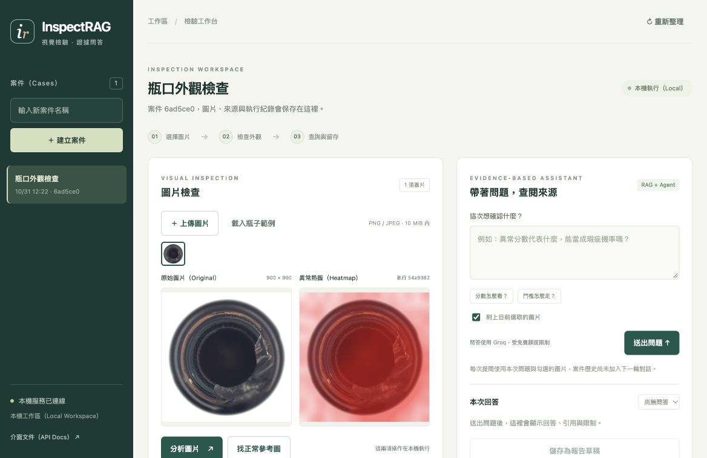
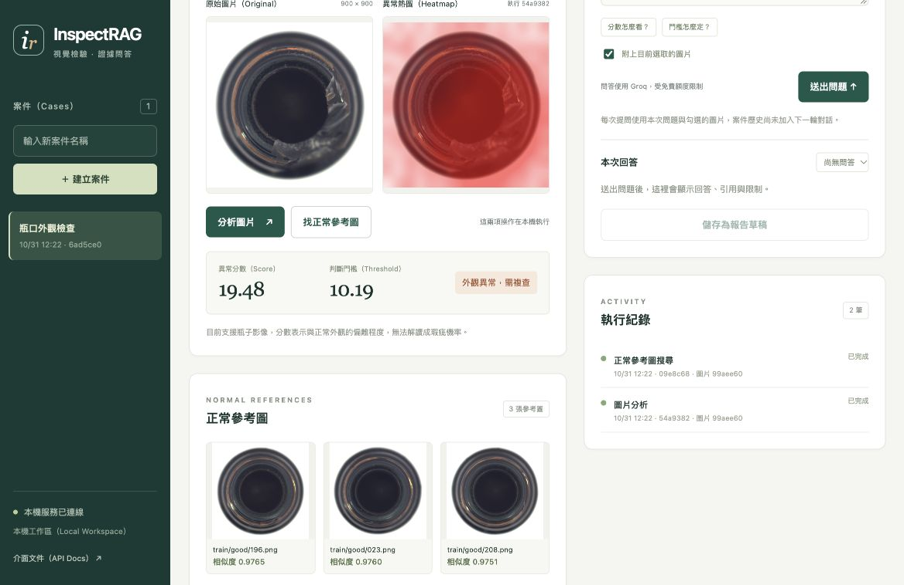

# 第六階段，把檢驗流程放進網頁工作台

## 這一版能做什麼

前一階段能透過介面文件（API Docs）建立案件與送出工作，這一版加入網頁工作台（Web Dashboard），讓圖片、分析、參考圖與回答放在同一個畫面，也能沿著案件查回之前的紀錄。

例如我建立「瓶口外觀檢查」案件，載入一張瓶子照片，按下「分析圖片」後，就能看到原圖、熱圖、異常分數與判斷門檻，接著按「找正常參考圖」，把模型找到的三張正常照片放在下面對照。

如果想知道分數怎麼解讀，可以在右側輸入問題，回答完成後會顯示來源與工具流程，核對內容後再存成報告草稿，勾選完成審閱才會開放確認按鈕。

這一階段不需要建立帳號、下載資料或安裝前端套件，瀏覽器沿用現有的本機服務，資料、模型、索引與 Groq 設定都接續前幾階段。

## 操作畫面

下圖為瀏覽器中的本機案件，圖片分析與正常參考圖搜尋使用真實模型，右側問答區尚未送出問題。



下圖顯示分析結果與參考圖，異常分數為 19.48，門檻為 10.19，三張正常參考圖依相似度排序。



畫面中的產品照片來自 [MVTec AD](https://www.mvtec.com/research-teaching/datasets/mvtec-ad)，照片與熱圖經過介面縮放及排列，相關截圖的來源與授權標示見[圖片說明](images/dashboard/README.md)。

## 現在完成的操作

| 操作 | 畫面會呈現什麼 |
|---|---|
| 建立或切換案件 | 案件名稱、圖片、執行紀錄與報告版本 |
| 上傳圖片 | 原圖、尺寸與已上傳圖片縮圖 |
| 載入瓶子範例 | 從本機資料集讀取固定範例，再透過上傳介面保存 |
| 分析圖片 | 原圖、熱圖、異常分數、判斷門檻與結果 |
| 搜尋正常參考圖 | 三張正常圖片、來源路徑與相似度 |
| 送出問題 | 狀態、附引用的回答、限制與工具流程 |
| 選擇歷史問答 | 讀回該次問題與回答，不重新呼叫模型 |
| 儲存報告草稿 | 回答、引用與工具紀錄的版本快照 |
| 確認報告 | 勾選已核對內容與來源後，寫入確認時間 |
| 下載紀錄 | 以 JSON 保存所選報告版本 |

## 怎麼開啟

在 VS Code 開啟專案資料夾，再於終端機執行以下指令，前一階段的服務若仍在執行，可沿用已更新的服務。

```bash
cd '/Users/chelsietao/vscode/InspectRAG Agent'
.venv/bin/python -m uvicorn app.backend:create_app --factory --host 127.0.0.1 --port 8000 --workers 1
```

開啟 [本機工作台](http://127.0.0.1:8000/)，介面文件保留在 [Swagger UI](http://127.0.0.1:8000/docs)，兩個畫面使用同一套後端與資料庫。

如果啟動時出現埠號已被使用，代表 8000 埠可能已有服務，請先開啟本機網址確認，程式碼更新後則需要停止原服務並重新啟動。

## 跑一次自己的案件

### 1. 建立案件，替這次檢查取名字

在左側輸入「瓶口外觀檢查」並建立案件，之後的圖片、分析、問題與報告都會保存在這個案件裡，切換案件時也會清除前一案件尚未送出的問題。

### 2. 上傳圖片，或載入範例

按「上傳圖片」選取 PNG 或 JPEG，也可以按「載入瓶子範例」，使用本機的 `bottle/test/broken_large/000.png`，這個操作不會開始分析或呼叫外部模型。

檔案上限為 10 MiB，像素總數上限為 1,600 萬，格式與解碼檢查由後端執行，前端也會先檢查檔案大小。

### 3. 分析圖片，再對照正常參考圖

按「分析圖片」，系統會在本機執行 PatchCore，工作進行中可以從執行紀錄看到狀態，完成後顯示熱圖與分數，按「找正常參考圖」則使用前一階段建立的正常圖片索引。

這兩個操作都在本機執行，不使用 Groq，參考圖只代表正常訓練圖片中外觀相近的候選，無法單憑相似度確認產品允收狀態或瑕疵成因。

同一張圖已有同類工作等待或執行時，對應按鈕會停用，重新整理則讀回保存的工作，不會重新送出分析。

### 4. 帶著問題查來源，決定是否附圖

在右側輸入「異常分數能當成瑕疵機率嗎，請附上來源」，如果只想查文件，可以取消「附上目前選取的圖片」，按「送出問題」後才會開始 Groq 代理流程。

問題完成後可以查看回答、來源連結、限制與工具執行順序，歷史問答選單可以讀回其他問題，選取歷史結果本身不會再次呼叫模型。

代理使用第四階段的次數與上下文限制，Groq 帳號需維持免費方案，遇到免費額度限制（Rate Limit）時會保存失敗原因，程式不會切換付費供應商或替失敗工作重試。

### 5. 儲存草稿，核對後確認版本

只有執行成功且回答狀態為 `answered` 的代理結果，才能按「儲存為報告草稿」，資料不足或需要補充資訊的結果會保留在問答紀錄中。

展開報告版本後，可以核對主張、引用、限制與工具流程，勾選「我已核對內容與引用來源」才會開放「確認這個版本」，確認時間保存後也能從案件重新查回。

「下載紀錄（JSON）」會匯出選定的報告快照，內容包含版本與證據，不包含 Groq 金鑰或整份案件資料庫。

## 前端與後端怎麼接

前端使用 HTML、樣式表（CSS）與 JavaScript 模組（JavaScript Modules），檔案由既有 FastAPI 服務提供，這一版不需要額外的前端建置服務或套件安裝。

```text
瀏覽器工作台
├── 案件列表 → /cases
├── 圖片上傳與顯示 → /cases/{case_id}/images
├── 圖片分析與問答 → /cases/{case_id}/runs
├── 正常參考圖 → 已保存的搜尋證據與參考圖介面
└── 報告審閱 → /cases/{case_id}/reports
```

前端在工作等待或執行時，每 1.5 秒讀取案件紀錄，沒有進行中的工作時停止輪詢（Polling），分頁隱藏時也會暫停，回到分頁再讀取狀態，這些讀取不會重新呼叫模型。

切換案件會遞增請求序號，舊案件的網路回覆即使晚到，也不會蓋掉新案件畫面，重新整理目前案件則保留選取的圖片與歷史問答。

送出工作時會建立請求編號，若網路中斷而沒有取得回覆，相同操作在目前分頁中重送會沿用原編號，後端會依第五階段的重送規則處理，這份暫存對照不會跨瀏覽器重新啟動保存。

## 新增與調整的介面

| 路徑或欄位 | 行為 |
|---|---|
| `GET /` | 提供工作台 HTML |
| `GET /assets/{name}` | 依允許清單提供三個前端檔案 |
| `GET /demo/bottle.png` | 提供固定的本機瓶子範例 |
| 建立工作時的 `kind: references` | 使用本機正常圖片搜尋，不呼叫語言模型 |
| `GET /cases/{case_id}/runs/{run_id}/references/{index}` | 讀取這次執行證據中的前三張參考圖 |
| 瀏覽器來源檢查（Origin Check） | 來源必須與目前本機服務的來源相同 |

參考圖介面會檢查案件關係、結果索引、路徑格式與 SHA-256 雜湊，檔案需位於正常訓練圖片目錄，使用者無法在網址填入任意本機路徑，檔案與原紀錄不同時會拒絕讀取。

畫面中的案件名稱、問題與模型回答都以文字節點（Text Node）加入，引用連結只接受不帶帳密的 HTTP 或 HTTPS 網址，模型產生的文字不會以 HTML 插入頁面。

## 這次怎麼驗證

| 驗證層級 | 結果與範圍 |
|---|---|
| Python 測試 | 81 項通過，包含既有資料、視覺、檢索、代理、後端與新增介面邊界 |
| JavaScript 測試 | 9 項通過，涵蓋圖片對應、引用連結、報告資格與文件問答的空圖片狀態 |
| 套件檢查 | `pip check` 通過，沒有新增 Python 或前端依賴 |
| 真實瀏覽器操作 | 建立案件、載入範例、分析與正常參考圖搜尋完成 |
| 問答與報告操作 | 在獨立本機服務使用歷史回答替身，驗證顯示、草稿與審閱確認 |
| 案件切換 | 新案件不帶入前一案件的問題、回答、報告或圖片面板 |
| 文字顯示 | 類似 HTML 的案件名稱以文字呈現，沒有建立對應的 HTML 元素 |
| 響應式版面（Responsive Layout） | 在瀏覽器 390px 寬度的測試畫框檢查操作、分數與參考圖排列 |

真實圖片使用 `broken_large/000.png`，異常分數為 **19.47983169555664**，門檻為 **10.19447135925293**，正常參考圖依序為 `196.png`、`023.png` 與 `208.png`，相似度為 **0.9765**、**0.9760** 與 **0.9751**。

本階段新增外部語言模型呼叫次數為 **0**，瀏覽器中的問答與報告流程使用替身驗證，語言模型整合的真實執行紀錄沿用第四階段，本次沒有新增模型品質或真實使用者成效的評估數字。

390px 驗證使用同一個瀏覽器中的固定寬度畫框，尚未驗證實體手機、跨瀏覽器相容性或輔助科技的完整可及性（Accessibility），畫面已加入欄位標籤、焦點樣式、圖片替代文字與狀態提示。

重跑程式驗證時，使用下列指令，JavaScript 測試使用 Node.js 內建的測試執行器，這次驗證版本為 v24.16.0，日常開啟工作台不需要啟動 Node.js。

```bash
.venv/bin/python -m unittest discover -s tests -v
node --test tests/test_ui_core.mjs
node --check web/app.js
.venv/bin/python -m pip check
```

完整紀錄位於[驗證摘要](evaluation/dashboard_v1/summary.json)，瀏覽器檢查項目位於[操作紀錄](evaluation/dashboard_v1/browser_checks.json)，更新後的介面格式則保存在[OpenAPI 規格](evaluation/dashboard_v1/openapi.json)。

## 檔案位置與保存方式

| 檔案 | 用途 |
|---|---|
| `web/index.html` | 工作台內容與表單結構 |
| `web/app.css` | 桌面與窄螢幕版面 |
| `web/app.js` | 案件、圖片、問答與報告操作 |
| `web/ui-core.mjs` | 圖片對應、引用網址與報告條件等共用邏輯 |
| `app/backend.py` | 同源網頁、正常參考圖與既有案件介面 |
| `tests/test_dashboard.py` | 靜態檔案與參考圖存取邊界測試 |
| `tests/test_ui_core.mjs` | 前端判斷邏輯測試 |

案件仍保存在 `artifacts/backend/`，本階段沒有更動資料庫版本，也沒有搬動既有案件，獨立介面測試資料保存在另一個被 Git 忽略的目錄，不會放進使用者的案件列表或 GitHub。

## 現階段限制

工作台提供本機單人操作，登入、多使用者權限、雲端部署、持久化工作佇列與大量案件分頁仍待實作，網址與主機檢查無法取代公開服務需要的身分驗證。

案件歷史可以保存與讀取，多輪摘要記憶尚未加入代理上下文，所以提問時仍需說明問題，或勾選要使用的圖片，畫面也會標示這個範圍。

報告確認表示使用者完成審閱，引用編號檢查仍無法替代主張支持度（Claim Support）的驗證，產品允收狀態與瑕疵成因需要另外的資料與判斷。

模型上下文協定（MCP）、容器（Docker）、持續整合（CI）與部署驗證會在後續階段處理，本階段先完成可操作的工作台與可重現的驗證紀錄。
