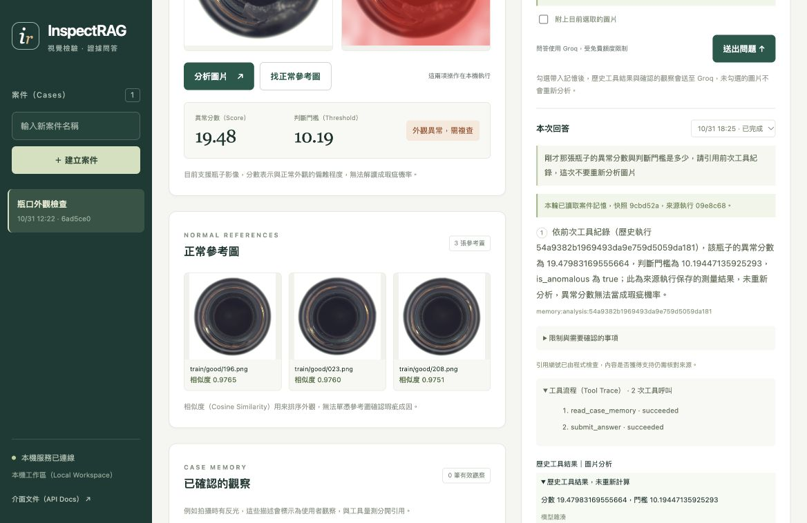

# 第七階段，讓追問能查回同一案件的依據

## 這一版解決什麼問題

前一版可以保存歷史問答，這一版讓代理在追問時讀取同案件的記憶快照（Memory Snapshot），例如詢問「剛才那張的分數是多少」，就能引用前次工具結果，並說明數字來自哪一次執行。

我把記憶內容分成歷史工具結果與使用者確認的觀察，模型前一輪寫出的解釋保留在歷史紀錄中，代理取用的新證據則由伺服器從來源執行與確認紀錄建立，避免把模型舊回答當成新的事實。

這一階段沒有需要建立的帳號或下載的資料，程式沿用本機 SQLite 與既有 Groq 設定，已保留原本的案件、圖片與分析，資料庫結構版本由 1 升級為 2。

## 真實追問的結果

在原本的瓶口案件中，取消「附上目前選取的圖片」，保留「帶入本案件記憶」，再詢問下列問題。

> 剛才那張瓶子的異常分數與判斷門檻是多少，請引用前次工具紀錄，這次不要重新分析圖片

最終版本使用兩次 Groq 呼叫，依序執行 `read_case_memory` 與 `submit_answer`，引用前次的分數 **19.47983169555664** 與門檻 **10.19447135925293**，本輪沒有執行圖片分析或重新搜尋正常參考圖。



畫面中的瓶子影像來自 MVTec AD，來源與截圖授權標示見[圖片說明](images/case-memory/README.md)，這是同一個案件的實際工具結果，無法據此推論整體追問成功率或真實產線成效。

本階段共做兩次線上追問、合計四次 Groq 呼叫，第一筆回答數值正確，但記憶狀態欄位影響了畫面標示，修正工具狀態與快照狀態的欄位衝突後，第二筆的讀取紀錄、引用與顯示皆通過核對，兩筆原始結果均保留。

## 現在能記住哪些內容

| 類型 | 保存內容 | 回答時的身分 |
|---|---|---|
| 歷史圖片分析 | 分數、門檻、異常判定、模型檢查點雜湊與來源執行 | 前次工具量測，未重新計算 |
| 歷史正常參考圖 | 最多三張圖片的路徑、雜湊與相似度 | 前次工具搜尋，未重新搜尋或驗證檔案 |
| 使用者確認觀察 | 使用者輸入的描述、圖片範圍、確認時間與撤回時間 | 使用者提供的描述，未經獨立驗證 |
| 近期問題提示 | 最多兩筆問題，每筆最多 240 字元 | 協助理解追問，無法當成事實引用 |

例如你確認「拍攝時瓶口有反光」，系統會保存成使用者觀察，代理可以說明這是你提供的資訊，現有內容仍不足以認定反光造成瑕疵或異常分數。

自由文字的長期對話摘要與模型推論記憶尚未加入，本版採用有來源的證據快照，讓每筆引用都能查回原始紀錄。

## 在工作台怎麼使用

### 1. 選擇案件與圖片，決定追問的範圍

開啟[本機工作台](http://127.0.0.1:8000/)，選擇原有案件與圖片，「追問來源」預設選用這張圖片最近完成的執行，也可以從選單指定來源編號。

如果案件有多張圖片，且沒有選擇圖片或來源執行，伺服器會將記憶狀態標示為需要指定來源（Needs Anchor），圖片相關追問需補充目標，通用文件問題仍可查文件。

### 2. 決定是否帶入記憶，以及是否允許重新分析

「帶入本案件記憶」控制是否提供歷史工具結果與觀察，「附上目前選取的圖片」控制這輪是否提供可供本機工具重新分析的圖片，兩項選擇分開處理。

如果只想查前次分數，可以保留記憶、取消附圖，伺服器仍會以圖片編號限定記憶範圍，工具則無法開始新的圖片分析。

勾選帶入記憶並送出問題後，相關的工具結果與確認描述可能會送至 Groq，圖片計算仍在本機執行，請只保存並送出你打算用於這次問答的內容。

### 3. 保存你確認過的觀察

在「已確認的觀察」輸入描述，選擇只套用目前圖片或整個案件，勾選「我確認這是我提供的觀察，並同意保存」後，才能按下保存按鈕。

例如「現場使用側面光源，瓶口有反光」，保存後會附上確認時間與適用範圍，代理沒有新增或確認觀察的工具，模型推測也不會加入這個列表。

### 4. 撤回觀察，保留追查紀錄

按「撤回觀察」後，新建立的快照會排除這筆描述，舊回答與舊快照保留當時的內容，畫面會提醒歷史回答引用的觀察已撤回。

引用已撤回觀察的結果，無法建立新的報告草稿，也無法確認尚未確認的草稿，先前已完成確認的報告則保留原確認時間，讓歷史紀錄維持可追查。

### 5. 核對回答與記憶來源

回答旁會顯示記憶快照雜湊與來源執行，展開引用可以查看歷史分數、門檻或使用者觀察，工具流程也會標示這輪是否讀取記憶，以及有沒有重新分析圖片。

例如記憶引用編號為 `memory:analysis:<run_id>`，就表示內容來自該次執行的量測，這個編號要經過本輪的 `read_case_memory` 讀取後，才能由代理引用。

## 記憶快照怎麼建立

建立工作時，伺服器會在同一個資料庫交易（Transaction）中確認案件、圖片與來源執行，選取可用資料、計算快照雜湊，再保存工作與快照。

快照的內容固定於工作被接受時，之後新增或撤回觀察不會重寫已接受工作的依據，所以等待中的舊工作也可能保留送出當時的描述，若觀察已撤回，畫面與報告檢查會依目前狀態提示或阻擋後續確認。

| 限制 | 本版設定 |
|---|---|
| 記憶快照字數 | 以標準化 JSON 計算，最多 6,000 字元 |
| 單筆觀察 | 最多 400 字元 |
| 納入的有效觀察 | 最多五筆，超出或因字數預算未納入時回報數量 |
| 近期問題 | 最多兩筆，每筆最多 240 字元 |
| 歷史工具來源 | 限同案件與同圖片，並檢查來源執行時間 |
| 查找工作範圍 | 先看最近 20 筆，必要時沿保存的來源編號回查，上限 40 筆 |
| 代理總上下文 | 沿用原本 22,000 字元限制，包含工具規格與本輪訊息 |
| 模型與工具次數 | 每輪最多五次模型呼叫、八次工具呼叫 |

6,000 字元是序列化資料的長度上限，無法直接當成 Token 數量，程式仍會在每次模型呼叫前檢查完整上下文預算，超過限制便停止該輪執行。

長對話若已引用原始分析，後續可以沿來源編號查回原量測，程式會重新讀取來源執行中的工具證據，前次模型主張中的數字不會被複製成量測結果。

## 代理可以做什麼，限制在哪裡

`read_case_memory` 不接受案件編號或其他參數，使用的案件與快照由後端建立，模型無法用工具切換到其他案件，也無法指定本機檔案或寫入觀察。

歷史證據讀取後才會加入本輪引用清單，直接引用前次的編號會被拒絕，文件定義與現行功能仍透過文件搜尋取得，歷史量測與使用者描述則附上各自的來源類型。

工具、文件與記憶中的文字都視為資料，提示會限制模型遵循其中的角色變更或寫入要求，工具權限與參數另由程式檢查，語意層級的提示注入（Prompt Injection）抵抗能力仍需更多實測。

引用編號檢查只能確認來源屬於本輪可用資料，主張支持度（Claim Support）仍需人工核對，使用者確認的描述也可能有誤，無法替代獨立量測或專業判斷。

## 新增的介面與欄位

| 方法與路徑 | 用途 |
|---|---|
| `GET /cases/{case_id}/facts` | 讀取確認觀察與撤回紀錄 |
| `POST /cases/{case_id}/facts` | 由使用者確認並新增觀察 |
| `POST /cases/{case_id}/facts/{fact_id}/retract` | 撤回觀察，保留原內容與時間 |
| `GET /cases/{case_id}/memory-preview` | 預覽可用記憶範圍，不呼叫模型 |
| `GET /cases/{case_id}/runs/{run_id}/memory` | 讀取該次工作保存的請求設定與記憶快照 |

建立代理工作時，新增三個欄位，未提供時沿用前一版不帶記憶的行為，舊請求的重送編號仍可取回原本的執行。

```json
{
  "kind": "agent",
  "question": "剛才的分數與門檻是多少，請引用前次紀錄",
  "image_id": null,
  "use_case_memory": true,
  "memory_image_id": "記憶範圍中的圖片編號",
  "context_run_id": "指定的來源執行編號，也可省略",
  "request_key": "followup-001"
}
```

`image_id` 提供本輪可分析的圖片，`memory_image_id` 限定歷史資料範圍，`context_run_id` 指定追問來源，若圖片與來源不相符會回傳 HTTP 409，跨案件的編號則回傳 HTTP 404。

一般 API 請求的 `use_case_memory` 預設為 false，網頁工作台會勾選並顯示這項選擇，取消後不會建立或傳送記憶快照。

## 資料結構與備份

資料庫新增 `case_facts` 與 `run_contexts`，原本的案件、圖片、執行與報告資料表保留，`PRAGMA user_version` 更新為 2，既有執行沒有快照時回傳記憶未啟用。

升級前的本機資料庫備份位於 `artifacts/phase7_backup/pre_memory_schema_v1.sqlite3`，原始案件與測試資料皆由 Git 忽略，備份沒有上傳 GitHub。

若要備份目前進度，請先停止服務，再複製完整 `artifacts/backend/`，資料庫、圖片與熱圖需要一起保存，這一階段沒有加入雲端同步或自動清理。

## 文件知識庫也跟著更新

原本的知識庫還寫著案件資料庫與記憶尚未實作，這一版已更新對應段落，使用既有本機多語言編碼器（Multilingual Encoder）重建文件索引，沒有下載新模型。

目前文件索引版本為 `documents-v2-case-memory`，保留 11 個來源與 32 個段落，原有圖片參考庫不變，固定的 12 題開發題與 12 題保留題也沒有修改。

更新後兩組題目的前五段召回率（Recall@5）皆為 100%，這是原本的小型作者自訂題集，無法代表獨立問答品質或記憶準確率，評估紀錄見[檢索更新結果](evaluation/retrieval_memory_v2/metrics.json)。

需要重整文件索引時，停止服務後可執行下列指令，程式會核對本機編碼器的雜湊、保留舊索引，再切換新版本，索引備份位於 `artifacts/index_backups/`。

```bash
.venv/bin/python scripts/prepare_knowledge.py
.venv/bin/python scripts/refresh_document_index.py --activate
```

## 這次怎麼測試

| 層級 | 驗證結果 |
|---|---|
| Python | 105 項測試通過，其中 24 項涵蓋記憶、觀察、來源、升級與報告撤回檢查 |
| JavaScript | 13 項測試通過，涵蓋追問來源選擇與撤回觀察判斷 |
| 套件檢查 | `pip check` 通過，沒有新增套件或帳號需求 |
| 真實代理 | 兩次追問皆取得正確歷史數字，最終版本的讀取狀態與來源核對通過 |
| 瀏覽器觀察流程 | 在獨立資料庫與離線代理中，驗證確認、保存、引用、撤回與撤回後的資訊不足 |
| 資料保留 | 原有一個案件、一張圖片與兩次本機執行保留，新增追問另存為新工作 |
| 檢索回歸 | 原有 24 題與圖片索引來源檢查通過，沒有修改評估題目 |

測試包含跨案件來源、圖片不符、未完成來源、記憶字數上限、快照遭修改、未讀取就引用、舊模型文字混入、長對話回查、舊請求重送、撤回觀察與舊報告的處理，離線測試不會呼叫 Groq。

```bash
.venv/bin/python -m unittest discover -s tests -v
node --test tests/test_ui_core.mjs
node --check web/app.js
.venv/bin/python -m pip check
```

公開紀錄包含[驗證摘要](evaluation/case_memory_v1/summary.json)、[最終線上回答](evaluation/case_memory_v1/live_followup.json)、[該次記憶快照](evaluation/case_memory_v1/live_snapshot.json)與[瀏覽器檢查項目](evaluation/case_memory_v1/browser_checks.json)，初版狀態欄位的修正前紀錄也保留，讓實測結果能對回開發變更。

## 現階段限制與後續範圍

本版提供同案件、有來源且字數受限的記憶，完整長對話摘要、語意挑選觀察、跨使用者權限、刪除與資料保留政策仍待實作，確認或撤回本身也無法保證描述符合實際情況。

同一張圖片在很長的歷史中若找不到原始證據，快照會缺少該項資料，使用者需要指定來源或重新分析，有限回查範圍不代表永久保存所有對話細節。

MCP、容器、持續整合與部署仍屬後續階段，目前服務維持本機單人使用，Groq 帳號需維持免費方案，程式不會升級或切換付費供應商，但無法透過模型 API 驗證帳號的計費層級。
